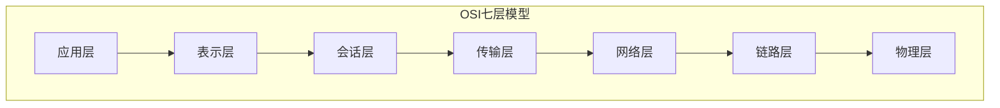
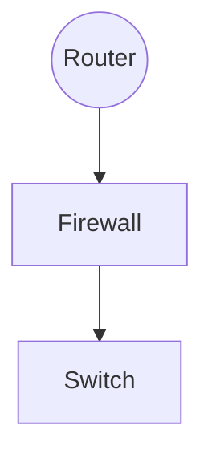

> Machine translated from Chinese by AI. For accuracy, please refer to the Chinese original.

# NU22 Recruitment Test

## Basics

1. 

- HTTP: Application layer, used for browsing, standardizes the data interaction characteristics between browsers and servers, listens on port 80 by default

​		Features:

(1) Simple and fast: requesting a service from the server only requires transmitting the request method and path, making HTTP server programs small in scale and communication fast

(2) Flexible: allows transmission of arbitrary types of data objects; the type being transmitted is marked with Content-Type

(3) Connectionless: each transmission handles only one request; after the server finishes processing the user's request, it immediately disconnects, saving transmission time

(4) Stateless: has no memory capability for transaction processing; missing state requires retransmission; the server does not need to process prior information, speeding up responses

(5) Supports B/S and C/S modes

(6) After HTTP/1.1, persistent connections are supported (one TCP connection sends multiple HTTP requests)

- SMTP: Application layer, provides efficient and reliable email transmission for users, listens on port 25 by default, and encrypted transmission uses port 465 by default. In practical applications, SMTP is generally used to send email, while POP3 and IMAP are generally used to receive email

  Features: It can relay email during transmission, i.e., relay transmission through hosts on different networks

- TCP: Transport layer, provides connection-oriented, reliable, end-to-end byte stream services for applications in the unreliable Internet.

  Features:

  (1) Connection-oriented: provides reliable methods for establishing and tearing down connections, and also provides flow control and congestion control mechanisms

  (2) Reliable delivery: provides error detection, acknowledgment, retransmission, and sequencing for segments, etc.

  (3) The segment header is long, so transmission overhead is high

- DNS: Application layer, used for domain name resolution; essentially a distributed database that maps domain names and IPs to each other.

  Features:

  (1) Distributed

  (2) The protocol supports TCP (response>512) and UDP (response<=512）,常用端口53

  （3）每一级域名长度限制是63

  （4）域名总长度限制253

- UDP:传输层，用于可靠性较高的网络环境（入局域网）或不要求可靠传输的场合，另外也常用于客户机/服务器模式

  特点：

  （1）传送数据前无需建立连接，无流量控制机制，数据到达后也无需确认

  （2）不可靠交付，只有有限的差错控制机制

  （3）报文头部段短，传输开销小，时延较短

- ICMP:网际层，主要用于在ip主机和路由器之间传递控制消息，用于报告主机是否可达，路由是否可用等

  特点：

  （1）差错报告采用路由器-源主机模式，路由器发现数据报传输出现错误时指向源主机报告差错原因

  （2）不能保证所有ip数据包都能够传输到目的主机

  （3）不能纠正差错，只能报告差错，差错处理需要高层协议完成

- ARP:网际层，网络设备要发送数据到另一台设备，数据被封装成帧需要对方mac地址，由ip地址获取mac地址通过arp完成

  特点：

  （1）报文不能穿越路由器，不能被转发到其他广播域

  （2）完整交互过程仅需要两个包

  （3）最不安全的一个协议

- RDP:应用层，基于T-120系列协议标准，是其拓展，支持多通道的协议，允许单独的虚拟通道传输（演示数据，串行设备通信，许可信息，高度加密的数据（键鼠活动等））T.share核心协议的拓展用于远程连接到计算机或服务器，允许用户使用电脑远程控制另一台电脑

  特点：

  （1）完全独立于基础传输堆栈，有5层网络层次，由下至上：网络连接层->ISO data layer -> virtual channel layer -> encryption/decryption layer -> functional data layer

  (2) Supports many different types of network topologies

  (3) Allows data to be stored more securely on local devices

  (4) There are certain network vulnerabilities; long-term use may be subject to network attacks

2. No default route configured, i.e., configure a static route


Take the above topology structure as an example

Figure 2.2 

Configuration commands (Huawei devices)

```shell
#配置AR1相应接口ip，配置到目标网络192.169.3.0/24	192.168.4.0/24
sys
int g0/0/0
ip add 192.168.1.254 255.255.255.0
int g0/0/1
ip add 192.168.2.1 255.255.255.0
q
ip route-static 192.168.3.0 255.255.255.0 192.168.2.2
ip route-static 192.168.4.0 255.255.255.0 192.168.2.2
#配置路由器AR2相应接口ip,并配置到192.168.1.0/24
sys
int g0/0/0
ip address 192.168.2.2 255.255.255.0
int g0/0/1
ip add 192.168.3.254 255.255.255.0
#在pc1,pc2,pc3上配置对应ip地址，网关以及子网掩码（图2.2,过程略）
#测试pc1,pc2,pc3之间连通性
查看AR1、AR2路由表
ip routing-table
#static为静态路由条目，direct为直连条目

```

---

Cisco device configuration

The following network topology

```shell
#内网配置
#对于Router0
enable
configure terminal
#打开以太网端口
interface fastEthernet 0/0
no shutdown
#配置ip
ip address 192.168.1.1 255.255.255.0
#配置广域网端口
interface serial 1/0
no shutdown
ip address 202.115.18.1 255.255.255.252
#配置时钟速率
clock rate 64000
end
write
```

```shell
#内网配置
#对于Router1
enable
configure terminal
#打开以太网端口,配置ip
interface fastEthernet 0/0
no shutdown
ip address 192.168.9.1 255.255.255.0
interface fastEthernet 0/1
no shutdown
ip address 192.168.5.1 255.255.255.0
#打开广域网端口，配置ip
interface serial 1/0
no shutdown
ip address 202.115.18.2 255.255.255.252
end
write
```

```shell
#配置路由
#Router0
enable
configure terminal
ip route 192.168.5.0 255.255.255.0 202.115.18.2
ip route 192.168.9.0 255.255.255.0 202.115.18.2
end
write
#Router1
enable
configure terminal
ip route 192.168.1.0 255.255.255.0 202.115.18.1
end
write
```

3.

The DHCP protocol uses UDP as the transport protocol. The host sends a request message to port 67, and the DHCP server responds with a message to the host's port 68.

Step 1. The DHCP client requests an IP and sends a DHCP Discover message by broadcast.

When the DHCP client starts, it automatically configures its IP as the non-communicable 0.0.0.0 and uses 0.0.0.0 as the source address. At this time, the client does not know the DHCP server's IP address, so it uses 0.0.0.0 as the source address, UDP port 68 as the source port, 255.255.255.255 as the destination address, and UDP port 67 as the destination port to request IP address information. The broadcast message contains the DHCP client's MAC address and computer name, making it easier for the DHCP server to locate which client sent the request.

Step 2: The server responds by sending a DHCP Offer message to the DHCP client.

When the DHCP server receives the DHCP Discover message, it responds, selects an unassigned IP from the IP pool to allocate to the DHCP client, and sends it as a DHCP Offer message. The DHCP Offer message also contains fields such as DNS address, gateway, and mask. If there is no IP available for allocation, it sends a DHCP NAK message to notify the DHCP client that no IP can be allocated.

Step 3: The DHCP client selects an IP and sends a broadcast DHCP Request message, adding the selected DHCP server address and the requested IP address in the option field.

The DHCP client sends a DHCP Request by broadcast, containing the DHCP server address and the requested IP. After the DHCP server receives the DHCP Request message, it determines whether the DHCP server's IP is the same as its own. If different, it clears the corresponding IP address allocation record; if the same, it responds to the DHCP client with a DHCP ACK message.

Step 4: The DHCP server confirms the lease, responds with a DHCP ACK message, and adds lease term information in the option field.

After the DHCP client receives the DHCP ACK message, it checks whether the allocated IP can be used. If it can be used, it automatically starts the renewal process according to the lease term. If it finds that it has already been used, the DHCP client sends a DHCP Decline message to the DHCP server to notify it to disable this IP address, after which the DHCP client starts a new IP application process.

4.

Unicast:

It refers to a transmission method in computer network packet transmission where the destination address is a single target. It is currently the most widely used network application; most commonly used network protocols or services use unicast transmission, for example, all TCP-based protocols.

Multicast:

Also called multicast, multipoint broadcast, or group broadcast. It refers to delivering information simultaneously to a group of destination addresses. Its strategy is the most efficient because the message only needs to be transmitted once on each network link, and the message is copied only when the link forks. It is used in many places, such as visual IP teleconferencing, video surveillance, some online live streaming, or network TV.

Anycast:

It is a network addressing and routing strategy that allows data to be sent to the "nearest" or "best" destination based on the routing topology. It is applied in DNS and mirror services.

Broadcast:

It refers to a transmission method in computer network packet transmission where the destination address is all devices in the network. "All devices" is also limited to a range, called a "broadcast domain". It is applied in DHCP.

5.

```shell
2: enp42s0: <BROADCAST,MULTICAST,UP,LOWER_UP> mtu 1500 qdisc fq_codel state
UP group default qlen 1000
link/ether d8:bb:c1:16:db:e1 brd ff:ff:ff:ff:ff:ff
inet 10.127.132.244/25 brd 10.127.132.255 scope global dynamic
noprefixroute enp42s0
valid_lft 166763sec preferred_lft 166763sec
inet6 2a0c:b641:7a2:1020:fc5d:264:c441:344f/64 scope global dynamic
noprefixroute
valid_lft 299956sec preferred_lft 199956sec
inet6 fe80::9e66:54c1:6c67:7ea2/64 scope link noprefixroute
valid_lft forever preferred_lft forever
```

- enp42s0 is the network interface name; p is the bus number, s is the slot number.

- mtu 1500 means maximum transmission unit is 1500, MAC header + body<=1500

- qdisc为排队规则，内核通过某个接口发送数据包，都需要为这个接口配置qdisc加入队列

- qlen为队列长度

- state up 代表接口已启用

- group default 接口组默认

- link/ether后续的d8:bb:c1:16:db:e1是mac地址

  brd后续的ff:ff:ff:ff:ff:ff是广播地址

- inet后续的10.127.132.244是ipv4地址，是一个a类地址

   25是子网掩码简写换成dec得到掩码为255.255.255.128,则ip地址范围为10.127.132.128～10.127.132.255,

  网络地址为10.127.132.128可用ip范围为10.127.132.129～10.127.132.254共125个地址

  brd后面为广播地址10.127.132.255

  global代表全局可用

  dynamic代表interface是动态创建销毁的

  noprefixroute 不为该地址的网络前缀分配路由，移除该地址也不去搜索路由

​		valid_lft 有效生存期

​		preferred_lft	首选生存期

- inet6后续为ipv6地址
- 第二个ipv6地址scope link代表地址仅在本地可用


6.

如果主机还未通过dhcp获取ip,则主机通过dhcp协议从dhcp server获取ip,掩码，网关ip。访问公网需要通过nat协议进行地址转换。对于域名，需要通过dns协议访问，访问 https://uestclug.org时，一般域名解析resopnse<=512，采用udp协议进行数据传输，获取到域名映射的ip地址后，通过tcp协议进行三次握手与服务器建立连接，但因为采用了https,所以三次握手之后进行tls协议的握手，之后发送加密过的http报文请求网页信息，最后tcp四次挥手与网页断开连接

主机与公网的通讯，所有数据包均需要通过路由器转发


7.

（1）支持802.1q协议的网卡的trunk支持native vlan，默认为vlan 1，则可以将外界设备划分到vlan1（缺省状态也可以）实现与外界通讯

（2）配置trunk接口允许通行的vlan,将外界设备所处vlan在trunk接口设置为通行


8.



PDU：应用层、表示层、会话层->data data

​			Transport layer: segment (TCP), datagram (UDP)

​			Network layer: packet

​			Link layer: frame

​			Physical layer: bit stream

Data processing process:

​			Application layer, presentation layer, session layer: generate upper-layer data

​			Transport layer: add TCP header (or UDP header)

​			Network layer: add IP header

​			Link layer: add frame header (preamble, MAC header, LLC header, type field) and frame trailer (CRC, interframe gap)

9. Layer 2 switches work at the OSI link layer. Layer 3 switches implement Layer 2 switching technology + Layer 3 forwarding technology, work at the link layer and network layer, and belong to switches with partial routing functions. Routers mainly interconnect LANs and WANs, are used for internetwork transmission, and work at the network layer.

Layer 2 switches are often used to build small LANs. Layer 3 switches mainly accelerate fast data forwarding within large LANs. If a large network uses Layer 2 switches, it cannot handle a large amount of internetwork access, while using routers, due to limited number of interfaces and slow forwarding speed, will limit network speed and network scale. In this case, using Layer 3 switches can better solve this problem.

Deployment location



10. Communication needs to be carried out through a router or Layer 3 switch. The router sets the port connected to the subnet as the subnet gateway to achieve communication; the Layer 3 switch sets up virtual interfaces between VLANs to achieve communication.

11. Network Address Translation, translates private network IPs to public network IPs so that intranet hosts can access the public network.

Disadvantages:

- Increases network complexity, makes security protocols more complex, and makes the network structure fragile. There is no true end-to-end connection between intranet hosts and public IPs, and it cannot fully support some higher-layer network protocols (such as TCP/UDP)

- NAT violates the design principle of the network layering model. OSI stipulates that layer n is not allowed to modify the header content of layer n+1, but NAT violates this principle: NAT, at the network layer, adds TCP/UDP headers that belong to the transport layer.

- Increases the router's workload. It needs to maintain the mapping relationship between private IP addresses, public IP addresses, and port numbers

- Cannot handle embedded IP addresses or ports. NAT can only modify IP headers in normal positions; NAT cannot process IP and port information embedded in application data

- NAT performs poorly in P2P

Advantages:

- Solves the problem of insufficient IPv4 addresses

- Effectively avoids attacks from outside the Ethernet

SNAT (source NAT POSTROUTING): Source Network Address Translation, converts the source address of an IP packet to another address. Often used for a LAN sharing one public IP to access the Internet

DNAT (Destination Network Address Translation): Destination Network Address Translation, converts the destination address of an external IP packet to an address in the intranet. Often used to publish intranet servers to the Internet

MASQUERADE: The address masquerading effect is similar to SNAT. It directly obtains the IP on the network interface that sends the data to replace the source IP. For situations where the IP is not fixed, such as dial-up networks or when IP is assigned via DHCP, MASQUERADE must be used.

12.

- Gateway device power outage

Devices within the office cannot ping each other; devices within the office cannot ping the server; loss is 100% in both cases.

- The server's upstream gateway is shut down

Office devices can ping each other; the office cannot ping the server; servers can ping each other; servers cannot ping the office.

- The enterprise intranet does not have a route to this server

There is no server IP address in the intranet routing table, so the server cannot be connected to from the intranet.

- Traffic is forwarded to the public network

The server cannot be accessed through the server's intranet IP, but can be accessed through the server's public IP.

13.


## Experimental Network

ASN4242422977

Already peered with :sheep:


