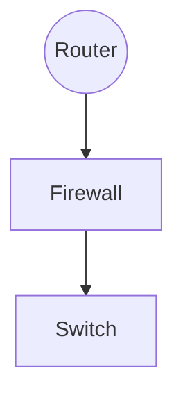

> この記事は中国語から AI により機械翻訳されたものです。正確性については中国語の原文を参照してください。

# NU22 新入部員募集問題

## 基礎

1. 

- HTTP：アプリケーション層。閲覧に用いられ、ブラウザとサーバ間のデータ交換の特徴を規定し、デフォルトで 80 番ポートをリッスンする

​		特徴：

（1）シンプルで高速。サーバにサービスを要求する際はリクエストメソッドとパスを送るだけでよく、HTTP サーバプログラムの規模を小さくし、通信速度を速くする

（2）柔軟：任意の種類のデータオブジェクトを伝送でき、伝送中の種類は Content-Type で示す

（3）コネクションレス：各伝送で 1 つのリクエストのみを処理し、サーバはユーザー要求を処理し終えると直ちに接続を切断し、伝送時間を節約する

（4）ステートレス：トランザクション処理に記憶能力がなく、状態が欠けると再送が必要になる。サーバは以前の情報を処理する必要がなく、応答を高速化できる

（5）B/S および C/S モデルをサポートする

（6）HTTP1.1 以降は持続的接続をサポートする（1 つの TCP で複数の HTTP リクエストを送信する）

- SMTP：アプリケーション層。ユーザーに効率的で信頼性の高いメール伝送を提供し、デフォルトで 25 番ポートをリッスンし、暗号化伝送ではデフォルトで 465 番ポートを使用する。実際のアプリケーションでは、通常 SMTP プロトコルでメールを送信し、通常 POP3、IMAP プロトコルでメールを受信する

  特徴：伝送中にリレー方式でメールを転送できる。すなわち、異なるネットワーク上のホストを介してリレー式に伝送する

- TCP：トランスポート層。信頼性の低いインターネットにおいて、アプリケーションにコネクション指向で信頼性の高いエンドツーエンドのバイトストリームサービスを提供する。

  特徴：

  （1）コネクション指向で、信頼性の高い接続確立と接続切断の方法を提供し、さらにフロー制御と輻輳制御の仕組みを提供する

  （2）信頼性のある配信を提供し、セグメントの誤り検出、確認、再送、順序制御などの機能を提供する

  （3）セグメントヘッダが長く、伝送オーバーヘッドが大きい

- DNS：アプリケーション層。ドメイン名解決に用いられ、実質的にはドメイン名と IP を相互にマッピングする分散データベースである。

  特徴：

  （1）分散型

  （2）プロトコルは TCP（response>512）と UDP（response<=512）,常用端口53

  （3）每一级域名长度限制是63

  （4）域名总长度限制253

- UDP:传输层，用于可靠性较高的网络环境（入局域网）或不要求可靠传输的场合，另外也常用于客户机/服务器模式

  特点：

  （1）传送数据前无需建立连接，无流量控制机制，数据到达后也无需确认

  （2）不可靠交付，只有有限的差错控制机制

  （3）报文头部段短，传输开销小，时延较短

- ICMP:网际层，主要用于在ip主机和路由器之间传递控制消息，用于报告主机是否可达，路由是否可用等

  特点：

  （1）差错报告采用路由器-源主机模式，路由器发现数据报传输出现错误时指向源主机报告差错原因

  （2）不能保证所有ip数据包都能够传输到目的主机

  （3）不能纠正差错，只能报告差错，差错处理需要高层协议完成

- ARP:网际层，网络设备要发送数据到另一台设备，数据被封装成帧需要对方mac地址，由ip地址获取mac地址通过arp完成

  特点：

  （1）报文不能穿越路由器，不能被转发到其他广播域

  （2）完整交互过程仅需要两个包

  （3）最不安全的一个协议

- RDP:应用层，基于T-120系列协议标准，是其拓展，支持多通道的协议，允许单独的虚拟通道传输（演示数据，串行设备通信，许可信息，高度加密的数据（键鼠活动等））T.share核心协议的拓展用于远程连接到计算机或服务器，允许用户使用电脑远程控制另一台电脑

  特点：

  （1）完全独立于基础传输堆栈，有5层网络层次，由下至上：网络连接层->ISO データ層->仮想チャネル層->暗号化/復号層->機能データ層

  （2）多くの異なる種類のネットワークトポロジをサポートする

  （3）データをより安全にローカルデバイス上に保存できる

  （4）一部のネットワーク脆弱性が存在し、長期間使用するとネットワーク攻撃を受ける可能性がある

2. デフォルト設定のルートがない場合、つまり静的ルートを設定する


上記のトポロジ構造を例とする

図2.2

設定コマンド（Huawei 機器）

```shell
#配置AR1相应接口ip，配置到目标网络192.169.3.0/24	192.168.4.0/24
sys
int g0/0/0
ip add 192.168.1.254 255.255.255.0
int g0/0/1
ip add 192.168.2.1 255.255.255.0
q
ip route-static 192.168.3.0 255.255.255.0 192.168.2.2
ip route-static 192.168.4.0 255.255.255.0 192.168.2.2
#配置路由器AR2相应接口ip,并配置到192.168.1.0/24
sys
int g0/0/0
ip address 192.168.2.2 255.255.255.0
int g0/0/1
ip add 192.168.3.254 255.255.255.0
#在pc1,pc2,pc3上配置对应ip地址，网关以及子网掩码（图2.2,过程略）
#测试pc1,pc2,pc3之间连通性
查看AR1、AR2路由表
ip routing-table
#static为静态路由条目，direct为直连条目

```

---

Cisco 機器の設定

以下のネットワークトポロジ

```shell
#内网配置
#对于Router0
enable
configure terminal
#打开以太网端口
interface fastEthernet 0/0
no shutdown
#配置ip
ip address 192.168.1.1 255.255.255.0
#配置广域网端口
interface serial 1/0
no shutdown
ip address 202.115.18.1 255.255.255.252
#配置时钟速率
clock rate 64000
end
write
```

```shell
#内网配置
#对于Router1
enable
configure terminal
#打开以太网端口,配置ip
interface fastEthernet 0/0
no shutdown
ip address 192.168.9.1 255.255.255.0
interface fastEthernet 0/1
no shutdown
ip address 192.168.5.1 255.255.255.0
#打开广域网端口，配置ip
interface serial 1/0
no shutdown
ip address 202.115.18.2 255.255.255.252
end
write
```

```shell
#配置路由
#Router0
enable
configure terminal
ip route 192.168.5.0 255.255.255.0 202.115.18.2
ip route 192.168.9.0 255.255.255.0 202.115.18.2
end
write
#Router1
enable
configure terminal
ip route 192.168.1.0 255.255.255.0 202.115.18.1
end
write
```

3.

DHCP プロトコルは UDP を伝送プロトコルとして採用し、ホストは要求メッセージを 67 番ポートへ送信し、DHCP サーバは応答メッセージをホストの 68 番ポートへ返す

ステップ1．DHCP クライアントは IP を要求し、ブロードキャスト方式で DHCP Discover メッセージを送信する。

DHCP クライアントは起動時に自動的に通信不能な 0.0.0.0 を IP として設定し、0.0.0.0 を送信元アドレスとする。このときクライアントは DHCP サーバの IP アドレスを把握していないため、0.0.0.0 を送信元アドレス、UDP 68 ポートを送信元ポートとし、255.255.255.255 を宛先アドレス、UDP 67 ポートを宛先ポートとして IP アドレス情報を要求する。ブロードキャスト情報には DHCP クライアントの MAC アドレスとコンピュータ名が含まれ、DHCP サーバがどのクライアントから送信された要求かを特定しやすくする

ステップ2：サーバが応答し、DHCP クライアントに DHCP Offer メッセージを送信する

DHCP サーバは DHCP Discover メッセージを受信すると応答し、未割り当ての IP プールから 1 つを選んで DHCP クライアントに割り当て、DHCP Offer メッセージとして送信する。DHCP Offer メッセージには DNS アドレス、ゲートウェイ、マスクなどのフィールドも含まれる。割り当て可能な IP がない場合、DHCP NAK メッセージを送信して DHCP クライアントに IP を割り当てられないことを通知する

ステップ3：DHCP クライアントは IP を選択し、ブロードキャストの DHCP Request メッセージを送信する。オプションフィールドに選択した DHCP サーバアドレスと必要な IP アドレスを追加する

DHCP クライアントはブロードキャスト方式で DHCP Request を送信し、DHCP サーバアドレスと要求する IP を含める。DHCP サーバは DHCP Request メッセージを受信した後、DHCP サーバの IP が自身と同じかどうかを判断する。異なる場合、対応する IP アドレス割り当て記録を削除し、同じ場合、DHCP クライアントに DHCP ACK メッセージを応答する

ステップ4：DHCP サーバはリースを確認し、DHCP ACK メッセージを応答し、オプションフィールドにリース期間情報を追加する

DHCP クライアントは DHCP ACK メッセージを受信した後、割り当てられた IP が使用可能かどうかを確認する。使用可能であれば、リース期間に基づいて自動的に更新プロセスを開始する。すでに使用されていると判明した場合、DHCP クライアントは DHCP サーバに DHCP Decline メッセージを送信し、この IP アドレスを無効にするよう通知する。その後、DHCP クライアントは新たな IP 申請プロセスを開始する

4.

Unicast（ユニキャスト）：

コンピュータネットワーク伝送において、宛先アドレスが単一のターゲットである伝送方式を指す。現在のネットワークアプリケーションで最も広く使われており、通常使用されるネットワークプロトコルやサービスの多くはユニキャスト伝送を採用している。たとえば TCP ベースのプロトコル全般などである。

Multicast（マルチキャスト）：

マルチキャスト、多点ブロードキャスト、またはグループキャストとも呼ばれる。情報を同時に一組の宛先アドレスへ配信することを指す。その方式は最も効率的である。なぜなら、メッセージは各ネットワークリンク上で一度だけ伝送されればよく、リンクが分岐するときのみメッセージが複製されるからである。ビジュアル IP 電話会議、ビデオ監視、一部のオンラインライブ配信やネットワークテレビなど、多くの場所で応用されている

Anycast（エニーキャスト）：

ネットワークアドレッシングとルーティングの戦略であり、データがルーティングトポロジに基づいて「最も近い」または「最良の」宛先へ送られるようにする。DNS やミラーサービスで応用されている

Broadcast（ブロードキャスト）：

コンピュータネットワークでパケットを伝送する際、宛先アドレスがネットワーク内のすべての機器である伝送方式を指す。「すべての機器」も一定の範囲に限定され、これを「ブロードキャストドメイン」と呼ぶ。DHCP で応用されている

5.

```shell
2: enp42s0: <BROADCAST,MULTICAST,UP,LOWER_UP> mtu 1500 qdisc fq_codel state
UP group default qlen 1000
link/ether d8:bb:c1:16:db:e1 brd ff:ff:ff:ff:ff:ff
inet 10.127.132.244/25 brd 10.127.132.255 scope global dynamic
noprefixroute enp42s0
valid_lft 166763sec preferred_lft 166763sec
inet6 2a0c:b641:7a2:1020:fc5d:264:c441:344f/64 scope global dynamic
noprefixroute
valid_lft 299956sec preferred_lft 199956sec
inet6 fe80::9e66:54c1:6c67:7ea2/64 scope link noprefixroute
valid_lft forever preferred_lft forever
```

- enp42s0 はネットワークインターフェース名で、p はバス番号、s はスロット番号

- mtu 1500 とは最大転送単位が 1500 であること、MAC ヘッダ + 本文<=1500

- qdisc为排队规则，内核通过某个接口发送数据包，都需要为这个接口配置qdisc加入队列

- qlen为队列长度

- state up 代表接口已启用

- group default 接口组默认

- link/ether后续的d8:bb:c1:16:db:e1是mac地址

  brd后续的ff:ff:ff:ff:ff:ff是广播地址

- inet后续的10.127.132.244是ipv4地址，是一个a类地址

   25是子网掩码简写换成dec得到掩码为255.255.255.128,则ip地址范围为10.127.132.128～10.127.132.255,

  网络地址为10.127.132.128可用ip范围为10.127.132.129～10.127.132.254共125个地址

  brd后面为广播地址10.127.132.255

  global代表全局可用

  dynamic代表interface是动态创建销毁的

  noprefixroute 不为该地址的网络前缀分配路由，移除该地址也不去搜索路由

​		valid_lft 有效生存期

​		preferred_lft	首选生存期

- inet6后续为ipv6地址
- 第二个ipv6地址scope link代表地址仅在本地可用


6.

如果主机还未通过dhcp获取ip,则主机通过dhcp协议从dhcp server获取ip,掩码，网关ip。访问公网需要通过nat协议进行地址转换。对于域名，需要通过dns协议访问，访问 https://uestclug.org时，一般域名解析resopnse<=512，采用udp协议进行数据传输，获取到域名映射的ip地址后，通过tcp协议进行三次握手与服务器建立连接，但因为采用了https,所以三次握手之后进行tls协议的握手，之后发送加密过的http报文请求网页信息，最后tcp四次挥手与网页断开连接

主机与公网的通讯，所有数据包均需要通过路由器转发


7.

（1）支持802.1q协议的网卡的trunk支持native vlan，默认为vlan 1，则可以将外界设备划分到vlan1（缺省状态也可以）实现与外界通讯

（2）配置trunk接口允许通行的vlan,将外界设备所处vlan在trunk接口设置为通行


8.


PDU：应用层、表示层、会话层->データdata

​			トランスポート層：segment セグメント（TCP）、datagram データグラム（UDP）

​			ネットワーク層：packet パケット

​			データリンク層：frame フレーム

​			物理層：bit ビットストリーム

データ処理プロセス：

​			アプリケーション層、プレゼンテーション層、セッション層：上位層データを生成

​			トランスポート層：TCP ヘッダ（または UDP ヘッダ）を追加

​			ネットワーク層：IP ヘッダを追加

​			データリンク層：フレームヘッダ（プリアンブル、MAC ヘッダ、LLC ヘッダ、タイプフィールド）とフレームトレーラ（CRC、フレーム間隔）を追加

9. レイヤ2スイッチは OSI データリンク層で動作し、レイヤ3スイッチはレイヤ2スイッチング技術 + レイヤ3転送技術を実現し、データリンク層とネットワーク層で動作し、部分的なルーティング機能を持つスイッチに属する。ルータは主に LAN と WAN を相互接続し、ネットワーク間伝送に用いられ、ネットワーク層で動作する

レイヤ2スイッチは小規模 LAN の構築によく用いられ、レイヤ3スイッチは主に大規模 LAN 内部のデータ高速転送を加速する。大規模ネットワークでレイヤ2スイッチを使用すると、大量のネットワーク間相互アクセスを処理できず、ルータを使用すると、インターフェース数の制限と転送速度の遅さによりネットワーク速度とネットワーク規模が制限される。このような場合、レイヤ3スイッチを使用すればこの問題をよりよく解決できる

配置位置



10. ルータまたはレイヤ3スイッチを介して通信する必要がある。ルータでは、サブネットに接続するポートをそのサブネットのゲートウェイに設定すれば通信を実現できる。レイヤ3スイッチでは、VLAN 間に仮想インターフェースを設定すれば通信を実現できる

11. Network Address Translation ネットワークアドレス変換。プライベート IP をグローバル IP に変換し、内部ネットワークのホストが公衆ネットワークにアクセスできるようにする

欠点：

- ネットワークの複雑さを増し、セキュリティプロトコルを複雑にし、ネットワーク構造を脆弱にする。内部ネットワークのホストとグローバル IP の間に真のエンドツーエンド接続が実現されず、上位層ネットワークの一部プロトコル（TCP/UDP など）を十分に利用できない
- NAT はネットワーク階層モデルの設計原則に違反する。OSI では第 n 層が第 n+1 層のヘッダ内容を変更してはならないと規定しているが、NAT はこの原則に違反し、NAT はネットワーク層にありながらトランスポート層にある TCP/UDP ヘッダを追加する
- ルータの作業負担を増やす。プライベート IP アドレスとグローバル IP アドレスおよびポート番号のマッピング関係を維持する必要がある
- 埋め込まれた IP アドレスやポートを処理できない。NAT は通常位置の IP ヘッダしか変更できず、アプリケーションデータに埋め込まれた IP とポート情報は NAT で処理できない
- NAT は P2P での動作が良くない

長所：

- IPv4 アドレス不足の問題を解決する
- イーサネット外部からの攻撃を効果的に回避する

SNAT（source NAT POSTROUTING）：送信元ネットワークアドレス変換。IP パケットの送信元アドレスを別のアドレスに変換する。主に LAN が 1 つのグローバル IP を共有してインターネットに接続する際に用いられる

DNAT（Destination Network Address Translation）：宛先ネットワークアドレス変換。外部 IP パケットの宛先アドレスを内部ネットワークの 1 つのアドレスに変換する。主に内部ネットワークサーバをインターネットに公開する際に用いられる

MASQUERADE：アドレス偽装の効果は SNAT に近い。送信データのネットワークインターフェース上の IP を直接取得して送信元 IP を置き換える。IP が固定でない場合、たとえばダイヤルアップネットワークや DHCP で IP を割り当てる場合には MASQUERADE を使う必要がある。

12.

- ゲートウェイ機器の電源断

オフィス内部で ping が通らない。オフィス内部からサーバに ping が通らない。loss はともに 100%

- サーバの上位ゲートウェイが閉鎖

オフィス機器間では ping が通る。オフィスからサーバには ping が通らない。サーバ間では ping が通る。サーバからオフィスには ping が通らない

- 企業内部ネットワークにそのサーバへのルートが存在しない

内部ネットワークのルーティングテーブルにサーバ IP アドレスがなく、内部ネットワークからサーバに接続できない

- トラフィックが公衆ネットワークに転送される

サーバの内部ネットワーク IP ではサーバにアクセスできないが、サーバのグローバル IP ではサーバにアクセスできる

13.


## 実験的ネットワーク

ASN4242422977

すでに :sheep: と peer した


