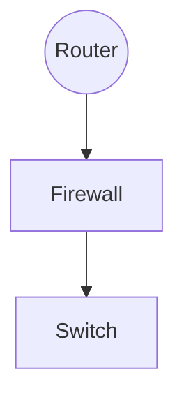

> この記事は中国語から AI により機械翻訳されたものです。正確性については中国語の原文を参照してください。

# NU22 新歓問題

## 基礎

1. 

- HTTP: アプリケーション層。閲覧に用いられ、ブラウザとサーバ間のデータ交換の特徴を規定し、デフォルトで80番ポートをリッスンする。

​		特徴:

（1）簡単で高速。サーバにサービスを要求するにはリクエストメソッドとパスのみを送ればよいため、HTTPサーバプログラムは規模が小さく、通信速度が速い。

（2）柔軟で、任意の種類のデータオブジェクトを転送できる。転送中の種類はContent-Typeで示す。

（3）コネクションレス。各転送で1つのリクエストのみを処理し、サーバはユーザリクエストを処理し終えると直ちに接続を切断するため、転送時間を節約する。

（4）ステートレス：トランザクション処理に記憶能力がなく、状態が欠けると再送が必要。サーバは以前の情報を処理する必要がなく、応答を高速化できる。

（5）B/SおよびC/Sモデルをサポートする。

（6）HTTP1.1以降は持続的接続（1つのTCPで複数のHTTPリクエストを送信）をサポートする。

- SMTP: アプリケーション層。ユーザに効率的で信頼性の高いメール転送を提供し、デフォルトで25番ポートをリッスンし、暗号化転送ではデフォルトで465番ポートを使用する。実際のアプリケーションでは、通常SMTPプロトコルでメールを送信し、通常POP3、IMAPプロトコルでメールを受信する。

特徴：転送中にメールをリレー転送できる。つまり、異なるネットワーク上のホストを介してリレー式に転送する。

- TCP: トランスポート層。信頼性の低いインターネットにおいて、アプリケーションにコネクション指向で信頼性の高いエンドツーエンドのバイトストリームサービスを提供する。

特徴：
（1）コネクション指向で、信頼性の高い接続確立と接続切断の方法を提供し、さらにフロー制御と輻輳制御のメカニズムも提供する。

（2）信頼性の高い配信。セグメントのエラー検出、確認応答、再送、順序制御などの機能を提供する。

（3）セグメントヘッダが長く、転送オーバーヘッドが大きい。

- DNS: アプリケーション層。ドメイン名解決に用いられ、本質的にはドメイン名とIPを相互にマッピングする分散データベースである。

特徴：
（1）分散型
（2）プロトコルはTCP（response>512）とUDP（response<=512）,常用端口53

  （3）每一级域名长度限制是63

  （4）域名总长度限制253

- UDP:传输层，用于可靠性较高的网络环境（入局域网）或不要求可靠传输的场合，另外也常用于客户机/服务器模式

  特点：

  （1）传送数据前无需建立连接，无流量控制机制，数据到达后也无需确认

  （2）不可靠交付，只有有限的差错控制机制

  （3）报文头部段短，传输开销小，时延较短

- ICMP:网际层，主要用于在ip主机和路由器之间传递控制消息，用于报告主机是否可达，路由是否可用等

  特点：

  （1）差错报告采用路由器-源主机模式，路由器发现数据报传输出现错误时指向源主机报告差错原因

  （2）不能保证所有ip数据包都能够传输到目的主机

  （3）不能纠正差错，只能报告差错，差错处理需要高层协议完成

- ARP:网际层，网络设备要发送数据到另一台设备，数据被封装成帧需要对方mac地址，由ip地址获取mac地址通过arp完成

  特点：

  （1）报文不能穿越路由器，不能被转发到其他广播域

  （2）完整交互过程仅需要两个包

  （3）最不安全的一个协议

- RDP:应用层，基于T-120系列协议标准，是其拓展，支持多通道的协议，允许单独的虚拟通道传输（演示数据，串行设备通信，许可信息，高度加密的数据（键鼠活动等））T.share核心协议的拓展用于远程连接到计算机或服务器，允许用户使用电脑远程控制另一台电脑

  特点：

  （1）完全独立于基础传输堆栈，有5层网络层次，由下至上：网络连接层->ISOデータ層->仮想チャネル層->暗号化復号層->機能データ層
（2）多くの異なる種類のネットワークトポロジをサポートする。
（3）データをより安全にローカルデバイスに保存できる。
（4）一部のネットワーク脆弱性が存在し、長期間使用するとネットワーク攻撃を受ける可能性がある。

2. デフォルト設定のルートがない、つまり静的ルートを設定する


上記のトポロジ構造を例とする

図2.2

設定コマンド（Huawei機器）

```shell
#配置AR1相应接口ip，配置到目标网络192.169.3.0/24	192.168.4.0/24
sys
int g0/0/0
ip add 192.168.1.254 255.255.255.0
int g0/0/1
ip add 192.168.2.1 255.255.255.0
q
ip route-static 192.168.3.0 255.255.255.0 192.168.2.2
ip route-static 192.168.4.0 255.255.255.0 192.168.2.2
#配置路由器AR2相应接口ip,并配置到192.168.1.0/24
sys
int g0/0/0
ip address 192.168.2.2 255.255.255.0
int g0/0/1
ip add 192.168.3.254 255.255.255.0
#在pc1,pc2,pc3上配置对应ip地址，网关以及子网掩码（图2.2,过程略）
#测试pc1,pc2,pc3之间连通性
查看AR1、AR2路由表
ip routing-table
#static为静态路由条目，direct为直连条目

```

---

Cisco機器の設定

以下のネットワークトポロジ

```shell
#内网配置
#对于Router0
enable
configure terminal
#打开以太网端口
interface fastEthernet 0/0
no shutdown
#配置ip
ip address 192.168.1.1 255.255.255.0
#配置广域网端口
interface serial 1/0
no shutdown
ip address 202.115.18.1 255.255.255.252
#配置时钟速率
clock rate 64000
end
write
```

```shell
#内网配置
#对于Router1
enable
configure terminal
#打开以太网端口,配置ip
interface fastEthernet 0/0
no shutdown
ip address 192.168.9.1 255.255.255.0
interface fastEthernet 0/1
no shutdown
ip address 192.168.5.1 255.255.255.0
#打开广域网端口，配置ip
interface serial 1/0
no shutdown
ip address 202.115.18.2 255.255.255.252
end
write
```

```shell
#配置路由
#Router0
enable
configure terminal
ip route 192.168.5.0 255.255.255.0 202.115.18.2
ip route 192.168.9.0 255.255.255.0 202.115.18.2
end
write
#Router1
enable
configure terminal
ip route 192.168.1.0 255.255.255.0 202.115.18.1
end
write
```

3.

DHCPプロトコルはUDPをトランスポートプロトコルとして採用し、ホストはリクエストメッセージを67番ポートへ送信し、DHCPサーバはホストの68番ポートへ応答メッセージを返す。

step1. DHCPクライアントはIPを要求し、ブロードキャスト方式でDHCP discoverメッセージを送信する。

DHCPクライアントは起動時に自動的にIPを通信不能な0.0.0.0に設定し、0.0.0.0を送信元アドレスとする。このときクライアントはDHCPサーバのIPアドレスを把握していないため、0.0.0.0を送信元アドレス、UDP 68番ポートを送信元ポートとし、255.255.255.255を宛先アドレス、UDP 67番ポートを宛先ポートとしてIPアドレス情報を要求する。ブロードキャスト情報にはDHCPクライアントのMACアドレスとコンピュータ名が含まれ、DHCPサーバがどのクライアントから送信された要求かを特定しやすくする。

step2：サーバが応答し、DHCPクライアントへDHCP offerメッセージを送信する。

DHCPサーバはDHCP discoverメッセージを受信すると応答し、未割り当てのIPプールから1つを選んでDHCPクライアントに割り当て、DHCP offerメッセージとして送信する。DHCP offerメッセージにはDNSアドレス、ゲートウェイ、マスクなどのフィールドも含まれる。割り当て可能なIPがない場合は、DHCP NAKメッセージを送信してDHCPクライアントにIPを割り当てられないことを通知する。

step3：DHCPクライアントはIPを選択し、ブロードキャストのDHCP requestメッセージを送信し、オプションフィールドに選択したDHCPサーバアドレスと必要なIPアドレスを追加する。

DHCPクライアントはブロードキャスト方式でDHCP requestを送信し、DHCPサーバアドレスと要求するIPを含める。DHCPサーバはDHCP requestメッセージを受信した後、DHCPサーバのIPが自身と同じかどうかを判断し、異なる場合は対応するIPアドレス割り当て記録を削除し、同じ場合はDHCPクライアントへDHCP ACKメッセージを応答する。

step4：DHCPサーバがリースを確認し、DHCP ACKメッセージを応答し、オプションフィールドにリース期間情報を追加する。

DHCPクライアントはDHCP ACKメッセージを受信した後、割り当てられたIPが使用可能か確認し、使用可能ならリース期間に従って自動的に更新プロセスを開始する。すでに使用されていると判明した場合、DHCPクライアントはDHCPサーバへDHCP Declineメッセージを送信し、このIPアドレスを無効にするよう通知し、その後DHCPクライアントは新たなIP申請プロセスを開始する。

4.

Unicast（ユニキャスト）：

パケットがコンピュータネットワーク上を転送される際に、宛先アドレスが単一のターゲットである伝送方式を指す。これは現在のネットワークアプリケーションで最も広く使われており、通常使用されるネットワークプロトコルやサービスの多くはユニキャスト伝送を採用している。例えばTCPベースのすべてのプロトコルなどである。

Multicast（マルチキャスト）：

マルチキャスト、多点ブロードキャスト、またはグループキャストとも呼ばれる。情報を同時に一連の宛先アドレスへ伝達することを指す。その使用戦略は最も効率的である。なぜなら、メッセージは各ネットワークリンク上を1回だけ通過すればよく、リンクが分岐するときにのみメッセージが複製されるからである。多くの場所で応用されており、例えば可視化IP電話会議、ビデオ監視、一部のオンラインライブ配信やネットワークテレビなどがある。

Anycast（エニーキャスト）：

ネットワークアドレッシングとルーティングの戦略であり、ルーティングトポロジに基づいてデータを「最も近い」または「最良の」宛先へ送ることを決定できる。DNSやミラーサービスで応用されている。

Broadcast（ブロードキャスト）：

パケットがコンピュータネットワーク上を転送される際に、宛先アドレスがネットワーク内のすべての機器である伝送方式を指す。「すべての機器」も1つの範囲に限定され、これを「ブロードキャストドメイン」と呼ぶ。DHCPで応用されている。

5.

```shell
2: enp42s0: <BROADCAST,MULTICAST,UP,LOWER_UP> mtu 1500 qdisc fq_codel state
UP group default qlen 1000
link/ether d8:bb:c1:16:db:e1 brd ff:ff:ff:ff:ff:ff
inet 10.127.132.244/25 brd 10.127.132.255 scope global dynamic
noprefixroute enp42s0
valid_lft 166763sec preferred_lft 166763sec
inet6 2a0c:b641:7a2:1020:fc5d:264:c441:344f/64 scope global dynamic
noprefixroute
valid_lft 299956sec preferred_lft 199956sec
inet6 fe80::9e66:54c1:6c67:7ea2/64 scope link noprefixroute
valid_lft forever preferred_lft forever
```

- enp42s0はネットワークカード名で、pはバス番号、sはスロット番号

- MTU 1500とは最大転送単位が1500であること、MACヘッダ＋本文<=1500

- qdisc为排队规则，内核通过某个接口发送数据包，都需要为这个接口配置qdisc加入队列

- qlen为队列长度

- state up 代表接口已启用

- group default 接口组默认

- link/ether后续的d8:bb:c1:16:db:e1是mac地址

  brd后续的ff:ff:ff:ff:ff:ff是广播地址

- inet后续的10.127.132.244是ipv4地址，是一个a类地址

   25是子网掩码简写换成dec得到掩码为255.255.255.128,则ip地址范围为10.127.132.128～10.127.132.255,

  网络地址为10.127.132.128可用ip范围为10.127.132.129～10.127.132.254共125个地址

  brd后面为广播地址10.127.132.255

  global代表全局可用

  dynamic代表interface是动态创建销毁的

  noprefixroute 不为该地址的网络前缀分配路由，移除该地址也不去搜索路由

​		valid_lft 有效生存期

​		preferred_lft	首选生存期

- inet6后续为ipv6地址
- 第二个ipv6地址scope link代表地址仅在本地可用


6.

如果主机还未通过dhcp获取ip,则主机通过dhcp协议从dhcp server获取ip,掩码，网关ip。访问公网需要通过nat协议进行地址转换。对于域名，需要通过dns协议访问，访问 https://uestclug.org时，一般域名解析resopnse<=512，采用udp协议进行数据传输，获取到域名映射的ip地址后，通过tcp协议进行三次握手与服务器建立连接，但因为采用了https,所以三次握手之后进行tls协议的握手，之后发送加密过的http报文请求网页信息，最后tcp四次挥手与网页断开连接

主机与公网的通讯，所有数据包均需要通过路由器转发


7.

（1）支持802.1q协议的网卡的trunk支持native vlan，默认为vlan 1，则可以将外界设备划分到vlan1（缺省状态也可以）实现与外界通讯

（2）配置trunk接口允许通行的vlan,将外界设备所处vlan在trunk接口设置为通行


8.


PDU：应用层、表示层、会话层->データdata

​			トランスポート層：segmentセグメント（TCP）、datagramデータグラム（UDP）

​			ネットワーク層：packetパケット

​			リンク層：frameフレーム

​			物理層：bitビットストリーム

データ処理過程：

​			アプリケーション層、プレゼンテーション層、セッション層：上位層データを生成

​			トランスポート層：TCPヘッダ（またはUDPヘッダ）を追加

​			ネットワーク層：IPヘッダを追加

​			リンク層：フレームヘッダ（プリアンブル、MACヘッダ、LLCヘッダ、タイプフィールド）とフレームトレーラ（CRC、フレーム間隔）を追加

9. L2スイッチはOSIリンク層で動作し、L3スイッチはL2スイッチング技術＋L3転送技術を実現し、リンク層とネットワーク層で動作し、部分的なルーティング機能を持つスイッチに属する。ルータは主にLANとWANを相互接続し、インターネットワーク転送に用いられ、ネットワーク層で動作する。

L2スイッチは主に小規模LANの構築に用いられ、L3スイッチは主に大規模LAN内部のデータ高速転送を加速する。大規模ネットワークでL2スイッチを使用すると大量のインターネットワーク相互アクセスを処理できず、ルータを使用するとインターフェース数の制限と転送速度の遅さによりネットワーク速度とネットワーク規模が制限される。このような場合、L3スイッチを使用すればこの問題をよりよく解決できる。

配置位置



10. ルータまたはL3スイッチを介して通信する必要がある。ルータはサブネットに接続するポートをそのサブネットのゲートウェイに設定すれば通信を実現でき、L3スイッチはVLAN間の仮想インターフェースを設定すれば通信を実現できる。

11. Network Address Translation ネットワークアドレス変換。プライベートIPをグローバルIPに変換し、内部ネットワークのホストが公衆網にアクセスできるようにする。

欠点：

- ネットワークの複雑性を増し、セキュリティプロトコルを複雑にし、ネットワーク構造を脆弱にする。内部ネットワークホストとグローバルIPの間に真のエンドツーエンド接続が実現されず、一部の上位ネットワークプロトコル（TCP/UDPなど）に依存できない。

- NATはネットワーク階層モデルの設計原則に反する。OSIでは第n層が第n+1層のヘッダ内容を変更してはならないと規定されているが、NATはこの原則に反し、NATはネットワーク層に位置しながらトランスポート層にあるTCP/UDPヘッダを追加する。

- ルータの作業負担を増やす。専用IPアドレスと公用IPアドレスおよびポート番号のマッピング関係を維持する必要がある。

- 埋め込まれたIPアドレスやポートを処理できない。NATは正常な位置のIPヘッダのみを変更でき、アプリケーションデータに埋め込まれたIPとポート情報はNATで処理できない。

- NATはP2Pでの動作が良くない。

長所：

- IPv4アドレス不足の問題を解決する
- イーサネット外部からの攻撃を効果的に回避する

SNAT（source NAT POSTROUTING）：送信元ネットワークアドレス変換。IPデータパケットの送信元アドレスを別のアドレスに変換する。通常、LANが1つのグローバルIPを共有してインターネットに接続する際に用いられる。

DNAT（Destination Network Address Translation）：宛先ネットワークアドレス変換。外部IPデータパケットの宛先アドレスを内部ネットワークの1つのアドレスに変換する。通常、内部ネットワークサーバをインターネットに公開する際に用いられる。

MASQUERADE：アドレス偽装の効果はSNATに近い。データを送信するネットワークカード上のIPを直接取得して送信元IPを置き換える。IPが固定でない場合、例えばダイヤルアップネットワークやDHCPでIPを割り当てる場合には、MASQUERADEを使う必要がある。

12.

- ゲートウェイ機器の電源断

オフィス内部でpingが通らず、オフィス内部からサーバへもpingが通らず、lossはどちらも100%である。

- サーバの上位ゲートウェイが停止

オフィス機器間ではpingが通るが、オフィスからサーバへはpingが通らない。サーバ間ではpingが通るが、サーバからオフィスへはpingが通らない。

- 企業内部ネットワークにそのサーバへのルートが存在しない

内部ネットワークのルーティングテーブルにサーバIPアドレスがなく、内部ネットワークからサーバへ接続できない。

- トラフィックが公衆網へ転送される

サーバの内部IPではサーバにアクセスできないが、サーバのグローバルIPではサーバにアクセスできる。

13.


## 実験的ネットワーク

ASN4242422977

すでに:sheep:とpeerした


