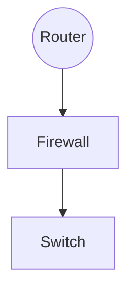

# NU22招新题

## 基础

1. 

- HTTP:应用层，用于浏览，规范了浏览器和服务器的数据交互特点，默认监听80端口

​		特点:

（1）简单快速，向服务器请求服务只需要传送请求方法和路径,使得http服务器程序规模小，通讯速度快

（2）灵活，允许传输任意类型数据对象，正在传输类型用Content-Type标记

（3）无连接，每次传输只处理一个请求，服务器处理完用户请求立即断开连接，节省传输时间

（4）无状态：对事务处理无记忆能力，缺少状态需要重传；服务器不需要处理先前信息加快应答

（5）支持B/S与C/S模式

（6）HTTP1.1版本后支持可持续连接(一个tcp发送多个http请求)

- SMTP:应用层，为用户提供高效、可靠的邮件传输，默认监听25端口，加密传输默认使用465端口。实际应用中，一般使用SMTP协议发送邮件，一般使用POP3,IMAP协议接收邮件

  特点：可以在传送中接力传送邮件，即通过不同网络上的主机接力式传送

- TCP:传输层，在不可靠的互联网中为应用程序提供哦年面向连接的，可靠的，端到端字节流服务。

  特点：

  （1）面向连接，提供可靠的建立连接和拆除连接的方法，还提供了流量控制和拥塞控制的机制

  （2）可靠交付，提供对报文段的检错，确认，重传和排序等功能

  （3）报文端头部长，传输开销大

- DNS:应用层，用于域名解析，实质上是一个域名与ip相互映射的分布式数据库。

  特点：

  （1）分布式

  （2）协议支持tcp(response>512)和udp（response<=512）,常用端口53

  （3）每一级域名长度限制是63

  （4）域名总长度限制253

- UDP:传输层，用于可靠性较高的网络环境（入局域网）或不要求可靠传输的场合，另外也常用于客户机/服务器模式

  特点：

  （1）传送数据前无需建立连接，无流量控制机制，数据到达后也无需确认

  （2）不可靠交付，只有有限的差错控制机制

  （3）报文头部段短，传输开销小，时延较短

- ICMP:网际层，主要用于在ip主机和路由器之间传递控制消息，用于报告主机是否可达，路由是否可用等

  特点：

  （1）差错报告采用路由器-源主机模式，路由器发现数据报传输出现错误时指向源主机报告差错原因

  （2）不能保证所有ip数据包都能够传输到目的主机

  （3）不能纠正差错，只能报告差错，差错处理需要高层协议完成

- ARP:网际层，网络设备要发送数据到另一台设备，数据被封装成帧需要对方mac地址，由ip地址获取mac地址通过arp完成

  特点：

  （1）报文不能穿越路由器，不能被转发到其他广播域

  （2）完整交互过程仅需要两个包

  （3）最不安全的一个协议

- RDP:应用层，基于T-120系列协议标准，是其拓展，支持多通道的协议，允许单独的虚拟通道传输（演示数据，串行设备通信，许可信息，高度加密的数据（键鼠活动等））T.share核心协议的拓展用于远程连接到计算机或服务器，允许用户使用电脑远程控制另一台电脑

  特点：

  （1）完全独立于基础传输堆栈，有5层网络层次，由下至上：网络连接层->ISO数据层->虚拟通道层->加密解密层->功能数据层

  （2）支持许多不同类型的网络拓补

  （3）允许数据更安全的储存在本地设备上

  （4）存在某些网络漏洞，长期使用可能会受到网络攻击

2.无默认配置的路由，即配置静态路由


以如上拓补结构为例

图2.2

配置指令(华为设备)

```shell
#配置AR1相应接口ip，配置到目标网络192.169.3.0/24	192.168.4.0/24
sys
int g0/0/0
ip add 192.168.1.254 255.255.255.0
int g0/0/1
ip add 192.168.2.1 255.255.255.0
q
ip route-static 192.168.3.0 255.255.255.0 192.168.2.2
ip route-static 192.168.4.0 255.255.255.0 192.168.2.2
#配置路由器AR2相应接口ip,并配置到192.168.1.0/24
sys
int g0/0/0
ip address 192.168.2.2 255.255.255.0
int g0/0/1
ip add 192.168.3.254 255.255.255.0
#在pc1,pc2,pc3上配置对应ip地址，网关以及子网掩码（图2.2,过程略）
#测试pc1,pc2,pc3之间连通性
查看AR1、AR2路由表
ip routing-table
#static为静态路由条目，direct为直连条目

```

---

思科cisco设备配置

如下网络拓补

```shell
#内网配置
#对于Router0
enable
configure terminal
#打开以太网端口
interface fastEthernet 0/0
no shutdown
#配置ip
ip address 192.168.1.1 255.255.255.0
#配置广域网端口
interface serial 1/0
no shutdown
ip address 202.115.18.1 255.255.255.252
#配置时钟速率
clock rate 64000
end
write
```

```shell
#内网配置
#对于Router1
enable
configure terminal
#打开以太网端口,配置ip
interface fastEthernet 0/0
no shutdown
ip address 192.168.9.1 255.255.255.0
interface fastEthernet 0/1
no shutdown
ip address 192.168.5.1 255.255.255.0
#打开广域网端口，配置ip
interface serial 1/0
no shutdown
ip address 202.115.18.2 255.255.255.252
end
write
```

```shell
#配置路由
#Router0
enable
configure terminal
ip route 192.168.5.0 255.255.255.0 202.115.18.2
ip route 192.168.9.0 255.255.255.0 202.115.18.2
end
write
#Router1
enable
configure terminal
ip route 192.168.1.0 255.255.255.0 202.115.18.1
end
write
```


3.

DHCP协议采用udp作为传输协议，主机发送请求消息到67端口，DHCP服务器回应消息给主机的68端口

step1. DHCP client请求ip,以广播方式发出DHCP discover报文。


DHCP client启动时会自动配置ip为不能通信的0.0.0.0,以0.0.0.0作为源地址。此时客户端不清楚DHCP server的ip地址，所以以0.0.0.0。为源地址，udp68port作为源端口，使用255.255.255.255作为目标地址，使用udp67port作为目的端口请求ip地址信息，广播信息包含了DHCP client的mac地址和计算机名，便于DHCP server定位是哪台客户端发出的请求


step2：server响应，向DHCP client发送DHCP offer报文


DHCP server接收到DHCP discover报文就会做出响应，从未分配过的ip池中挑选一个分配给DHCP client，以DHCP offer报文发出，DHCP offer报文中还包含了dns地址，网关，掩码等字段。如果无可用来分配的ip,ze发送DHCP NAK报文通知DHCP client无法分配ip


step3：DHCP client选择ip，发出一个广播的DHCP request报文，选项字段中加入选中的DHCP server地址和需要的ip地址


DHCP client以广播方式发送DHCP request，包含了DHCP server地址和请求的ip。DHCP server接收DHCP request报文后，判断DHCP server的ip是否与自己的相同，若不同，则清除相应ip地址分配记录，若相同，则向DHCP client响应一个DHCP ACK报文


step4：DHCP server确认租约，响应DHCP ACK报文，在选项字段中添加租期信息


DHCP client接收到DHCP ACK报文后，检查分配的ip是否可以使用，若能使用，则根据租期自动启动续延过程，如果发现已经被使用，则DCHP client向DHCP server发送DHCP Decline报文，通知其禁用此ip地址，之后DHCP client开始新的ip申请过程

4.

Unicast（单播）：

是指封包在计算机网络的传输中，目的地址为单一目标的一种传输方式。它是现今网络应用最为广泛，通常所使用的网络协议或服务大多采用单播传输，例如一切基于TCP的协议。

Multicast（组播）：

也叫多播， 多点广播或群播。 指把信息同时传递给一组目的地址。它使用策略是最高效的，因为消息在每条网络链路上只需传递一次，而且只有在链路分叉的时候，消息才会被复制。很多地方都有应用，如可视化ip电话会议、视频监控、一些线上直播或网络电视

Anycast（任播）：

是一种网络寻址和路由的策略，使得资料可以根据路由拓朴来决定送到“最近”或“最好”的目的地。在DNS和镜像服务中有所应用

Broadcast（广播）：

是指封包在计算机网络中传输时，目的地址为网络中所有设备的一种传输方式。“所有设备”也是限定在一个范围之中，称为“广播域”。在DHCP中就有所应用


5.

```shell
2: enp42s0: <BROADCAST,MULTICAST,UP,LOWER_UP> mtu 1500 qdisc fq_codel state
UP group default qlen 1000
link/ether d8:bb:c1:16:db:e1 brd ff:ff:ff:ff:ff:ff
inet 10.127.132.244/25 brd 10.127.132.255 scope global dynamic
noprefixroute enp42s0
valid_lft 166763sec preferred_lft 166763sec
inet6 2a0c:b641:7a2:1020:fc5d:264:c441:344f/64 scope global dynamic
noprefixroute
valid_lft 299956sec preferred_lft 199956sec
inet6 fe80::9e66:54c1:6c67:7ea2/64 scope link noprefixroute
valid_lft forever preferred_lft forever
```

- enp42s0是网卡名称，p是总线编号，s是插槽编号

- mtu 1500即最大传输代为1500,mac头+正文<=1500

- qdisc为排队规则，内核通过某个接口发送数据包，都需要为这个接口配置qdisc加入队列

- qlen为队列长度

- state up 代表接口已启用

- group default 接口组默认

- link/ether后续的d8:bb:c1:16:db:e1是mac地址

  brd后续的ff:ff:ff:ff:ff:ff是广播地址

- inet后续的10.127.132.244是ipv4地址，是一个a类地址

   25是子网掩码简写换成dec得到掩码为255.255.255.128,则ip地址范围为10.127.132.128～10.127.132.255,

  网络地址为10.127.132.128可用ip范围为10.127.132.129～10.127.132.254共125个地址

  brd后面为广播地址10.127.132.255

  global代表全局可用

  dynamic代表interface是动态创建销毁的

  noprefixroute 不为该地址的网络前缀分配路由，移除该地址也不去搜索路由

​		valid_lft 有效生存期

​		preferred_lft	首选生存期

- inet6后续为ipv6地址
- 第二个ipv6地址scope link代表地址仅在本地可用


6.

如果主机还未通过dhcp获取ip,则主机通过dhcp协议从dhcp server获取ip,掩码，网关ip。访问公网需要通过nat协议进行地址转换。对于域名，需要通过dns协议访问，访问 https://uestclug.org时，一般域名解析resopnse<=512，采用udp协议进行数据传输，获取到域名映射的ip地址后，通过tcp协议进行三次握手与服务器建立连接，但因为采用了https,所以三次握手之后进行tls协议的握手，之后发送加密过的http报文请求网页信息，最后tcp四次挥手与网页断开连接

主机与公网的通讯，所有数据包均需要通过路由器转发


7.

（1）支持802.1q协议的网卡的trunk支持native vlan，默认为vlan 1，则可以将外界设备划分到vlan1（缺省状态也可以）实现与外界通讯

（2）配置trunk接口允许通行的vlan,将外界设备所处vlan在trunk接口设置为通行


8.


PDU：应用层、表示层、会话层->数据data

​			传输层：segment报文段（tcp），datagram数据报（udp）

​			网络层：packet数据包

​			链路层：frame数据帧

​			物理层：bit比特流

数据处理过程：

​			应用层、表示层、会话层：生成上层数据

​			传输层：添加tcp头（或udp头）

​			网络层：添加ip头

​			链路层：添加帧头（前同步码，mac头，LLC头，类型字段）和帧尾（CRC，帧间距）

9.二层交换机工作在osi链路层，三层交换机实现了二层交换技术+三层转发技术，工作在链路层和网络层，属于具有部分路由功能的交换机，路由器主要互联局域网和广域网，用于网际传输，工作在网络层

二层交换机常用于组建小型局域网，三层交换机主要加速了大型局域网络内部的数据快速转发，大型网络如果使用二层交换机无法处理大量的网际互访，而使用路由器由于接口数量限制和转发速度满会限制网速和网络规模，此时使用三层交换机就可以较好解决此问题


部署位置




10.需要通过路由器或三层交换机进行通讯，路由器将接入子网的端口设置为子网的网关即可实现通信，三层交换机将vlan之间虚接口起来即可实现通信

11.Network Address Translation网络地址转换，将私网ip转换为公网ip实现内网主机可以访问到公网

缺点：

- 增加了网络复杂性，使得安全协议变复杂，网络结构脆弱。内网主机和公网ip之间没有实现真正的端对端连接，无法沉溺于高层网络的一些协议（如tcp/udp）
- NAT违背了网络分层模型设计原则。osi中规定第n层不允许修改n+1层报头内容，但nat违背了这一原则，nat处于网络层增添了位于传输层的tcp/udp报头，
- 增加了路由器工作负担。需要维护专用IP地址与公用IP地址以及端口号的映射关系
- 不能处理嵌入式IP地址或端口。nat只能修改正常位置的ip头，嵌入到应用数据的ip和端口信息nat无法进行处理
- nat在p2p中的表现不好

优点：

- 解决了ipv4地址不足的问题
- 有效避免了来自以太网外部的攻击

SNAT（source NAT POSTROUTING）：源网络地址转换，将ip数据包的源地址转换为另外一个地址。常用于局域网共享一个公网ip接入Internet

DNAT（Destination Network Address Translation）：目的网络地址转换，将外部ip数据包的目标地址转换为内网的一个地址。常用于向Internet发布内网服务器

MASQUERADE：地址伪装效果与snat相近。是直接获取发送数据的网卡上IP来替换源IP，对于IP不固定的场合，比如拨号网络或者通过dhcp分配IP的情况下，就得用MASQUERADE。

12.

- 网关设备断电

办公室内部无法ping通，办公室内部无法ping通服务器，loss都为100%

- 服务器上级网关关闭

办公室设备之间可以ping通，办公室无法ping通服务器，服务器之间可以ping通，服务器无法ping通办公室

- 企业内部网络不存在该服务器路由

内部网络路由表中无服务器ip地址，无法从内网连接到服务器

- 流量转发到公网

无法通过服务器内网ip访问服务器，可以通过服务器公网ip访问到服务器

13.


## 实验性网络

ASN4242422977

已经和:sheep:peer了


