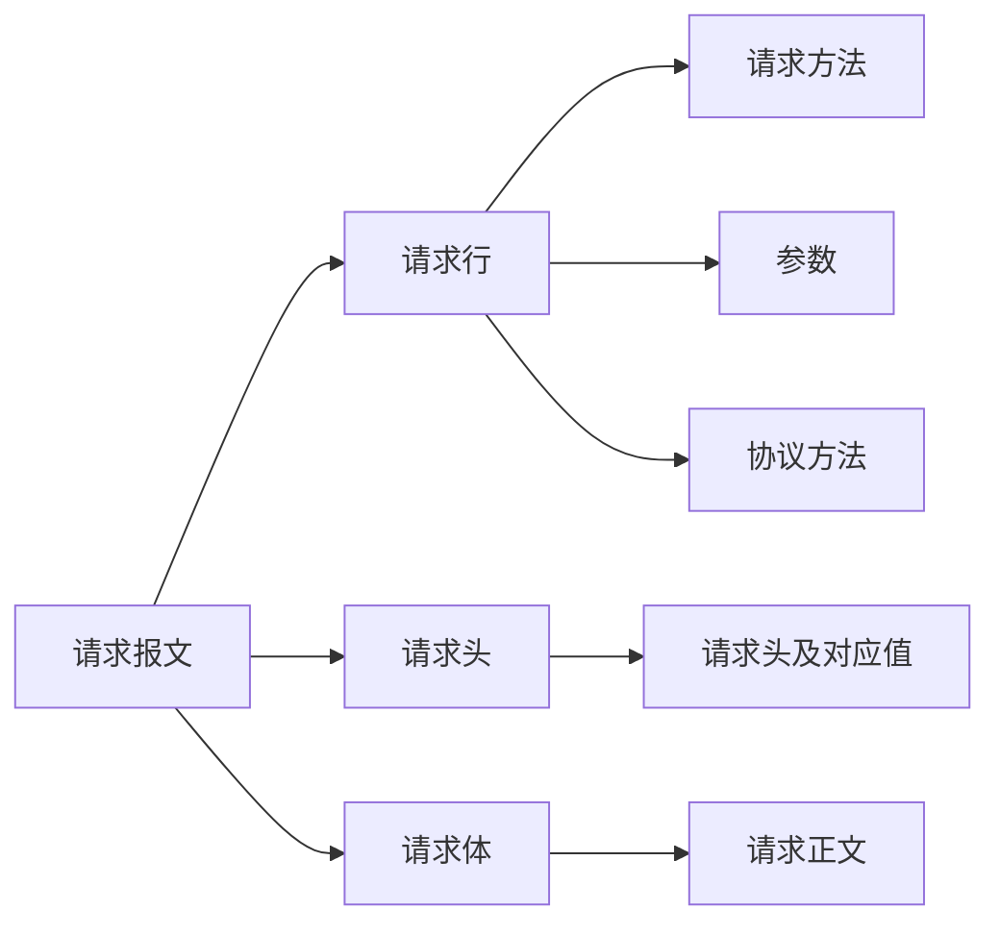
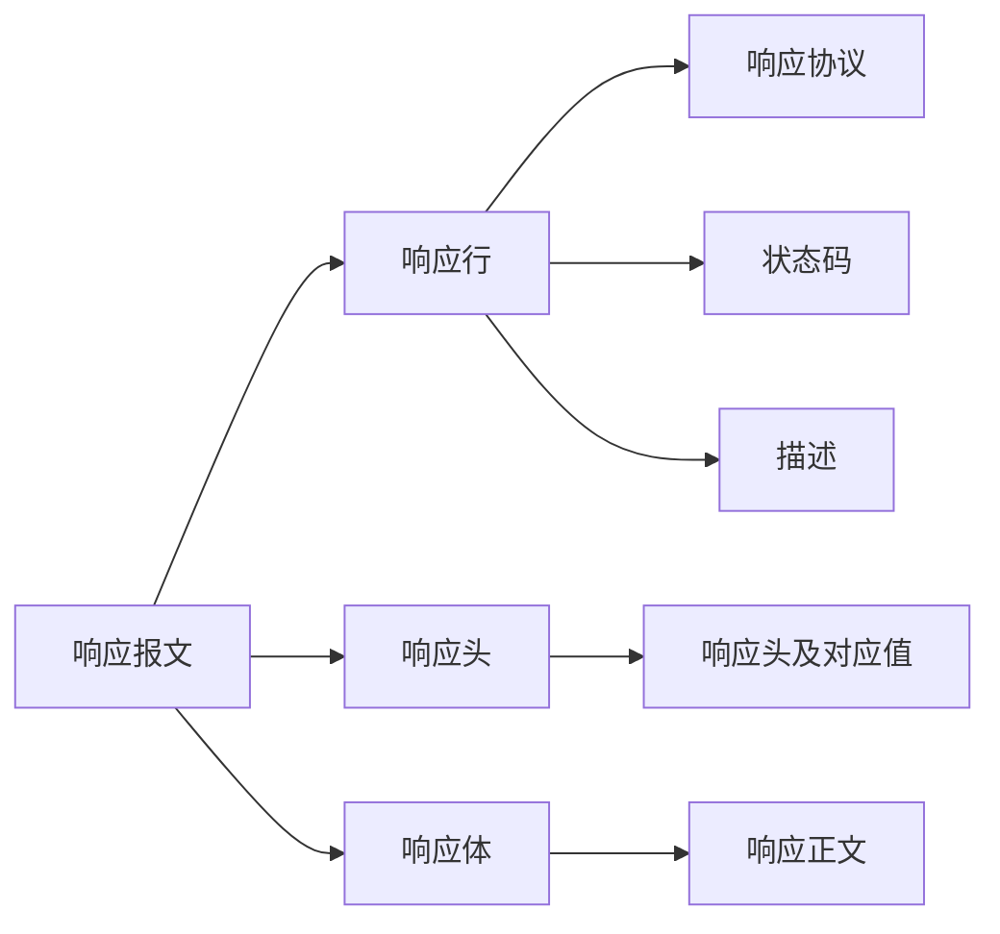

> Machine translated from Chinese by AI. For accuracy, please refer to the Chinese original.

# HTTP

Request, response

Request message:

- Request line
- Request headers
- Request body

Response message:

- Response line
- Response headers
- Response body

## Line

### Request Methods

There are multiple request methods (all methods are uppercase). The explanations of each method are as follows:

GET   Requests to retrieve the resource identified by the Request-URI

POST  Appends new data after the resource identified by the Request-URI

HEAD  Requests to retrieve the response message header of the resource identified by the Request-URI

PUT   Requests the server to store a resource and use the Request-URI as its identifier

DELETE Requests the server to delete the resource identified by the Request-URI

TRACE  Requests the server to echo back the received request information, mainly used for testing or diagnostics

CONNECT Reserved for future use

OPTIONS Requests to query the server's capabilities, or query options and requirements related to a resource

## Headers

### Request Headers

Accept Through this header, the browser tells the server the data types it supports.

Accept-Charset Through this header, the browser tells the server the character set it uses.

Accept-Encoding Through this header, the browser tells the server the compression formats it supports.

Accept-Language Through this header, the browser tells the server the language it uses.

Host Through this header, the browser tells the server which host on the server I want to access.

If-Modified-Since Through this header, the browser tells the server what time the cached data was from.

Referer Through this header, the browser tells the server which web page I clicked from (anti-hotlinking).

User-Agent Through this header, the browser tells the server information about the current browser operating system and the browser version number.

Connection This header identifies whether this request uses a persistent connection or a non-persistent connection.

Date

### Response Headers

Location This header is usually used together with the 302 status code; it is used to tell the browser who to go to.

Server Tells the browser the type of server.

Content-Encoding Through this header, the server tells the browser the compression format used for the returned data.

Content-Length: 80

Content-Language: zh-cn

Content-Type This header is used to tell the browser the type of the returned data.

Last-Modified This header is used to tell the browser the last modification time of the data.

Refresh This header is used to control the browser's scheduled refresh.

Content-Disposition Used to notify the browser to open the returned data as a download.

Transfer-Encoding Used to notify the browser that the data is returned in chunked form.

ETag A cache-related header.

Expires Used to indicate the expiration time of a web page. If the value is <0, the server is telling the browser not to cache.

Cache-Control: no-cache Tells the browser not to cache.

Pragma: no-cache

 

Data types:

text/html: HTML format
text/plain : Plain text format
text/xml : XML format
image/gif : GIF image format
image/jpeg : JPG image format
image/png: PNG image format
video/mpeg: video
vedio/quicktime: video
application/xhtml+xml : XHTML format
application/xml : XML data format
application/atom+xml : Atom XML aggregation format
application/json : JSON data format
application/pdf : PDF format
application/msword : Word document format
application/octet-stream : Binary stream data (such as common file downloads)
application/x-www-form-urlencoded : The default encType in ` < form encType=””>`, where form data is encoded in key/value format and sent to the server (the default format for submitting form data)

## Status Codes

- 1xx: The server has received the browser message but has not completed processing
- 2xx: Success, 200
- 3xx: Redirection, 302, 304 (access cache)
- 4xx: Client error, 401 (unauthenticated), 404 (requested resource not found), 403 (no permission to access), 405 (request method not allowed)
- 5xx: Server error, 500 (internal server exception)

---

GET passes in data through /?variable=value

POST directly assigns and passes in data in the request body

## Attachments

- [Cybersecurity Experiment.7z](%E7%BD%91%E5%AE%89%E5%AE%9E%E9%AA%8C.7z)