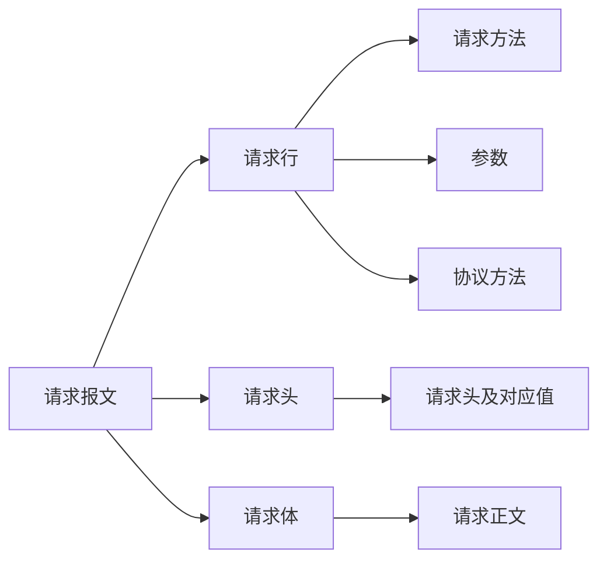
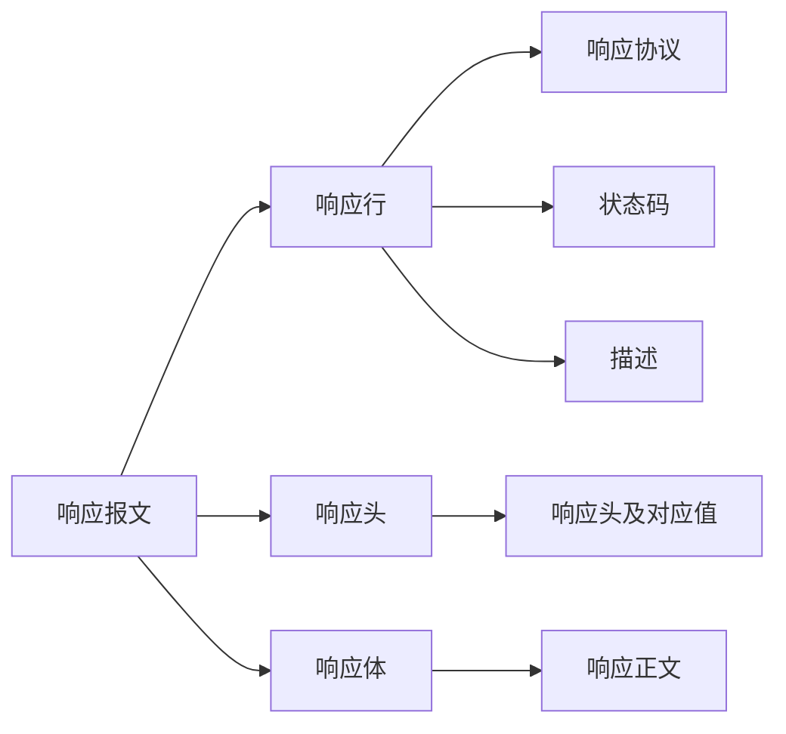

> この記事は中国語から AI により機械翻訳されたものです。正確性については中国語の原文を参照してください。

# HTTP

リクエスト（request）、レスポンス（response）

リクエストメッセージ：

- リクエスト行
- リクエストヘッダー
- リクエストボディ

レスポンスメッセージ：

- レスポンス行
- レスポンスヘッダー
- レスポンスボディ

## 行

### リクエストメソッド

リクエストメソッド（すべてのメソッドは大文字）には複数あり、各メソッドの説明は以下のとおりです：

GET   Request-URI で識別されるリソースの取得を要求する

POST  Request-URI で識別されるリソースに新しいデータを追加する

HEAD  Request-URI で識別されるリソースのレスポンスメッセージヘッダーの取得を要求する

PUT   サーバーにリソースを保存し、Request-URI をその識別子として使用するよう要求する

DELETE Request-URI で識別されるリソースの削除をサーバーに要求する

TRACE  サーバーが受信したリクエスト情報を送り返すよう要求する。主にテストや診断に使用される

CONNECT 将来の使用のために予約

OPTIONS サーバーの性能、またはリソースに関連するオプションや要件の照会を要求する

## ヘッダー

### リクエストヘッダー

Accept ブラウザはこのヘッダーを通じて、サーバーに自身がサポートするデータ型を伝える

Accept-Charset ブラウザはこのヘッダーを通じて、サーバーに自身が採用する文字セットを伝える

Accept-Encoding ブラウザはこのヘッダーを通じて、サーバーに自身がサポートする圧縮形式を伝える

Accept-Language ブラウザはこのヘッダーを通じて、サーバーに自身が採用する言語を伝える

Host ブラウザはこのヘッダーを通じて、サーバーに「サーバーのどのホストにアクセスしたいか」を伝える

If-Modified-Since ブラウザはこのヘッダーを通じて、サーバーに自身がキャッシュしたデータの時刻を伝える。

Referer ブラウザはこのヘッダーを通じて、サーバーに自分がどの Web ページからクリックして来たかを伝える（ホットリンク防止）

User-Agent ブラウザはこのヘッダーを通じて、サーバーに現在のブラウザと OS の情報、およびブラウザのバージョン番号を伝える

Connection このヘッダーを通じて、今回のリクエストが持続接続か非持続接続かを識別する

Date

### レスポンスヘッダー

Location このヘッダーは通常 302 ステータスコードと併用され、ブラウザにどこへ移動すべきかを伝えるために使用される。

Server ブラウザにサーバーの種類を伝える

Content-Encoding サーバーはこのヘッダーを通じて、ブラウザに返送データで使用される圧縮形式を伝える。

Content-Length: 80

Content-Language: zh-cn

Content-Type このヘッダーは、ブラウザに返送データの型を伝えるために使用される

Last-Modified このヘッダーは、ブラウザにデータの最終更新時刻を伝えるために使用される

Refresh このヘッダーは、ブラウザの定期的なリフレッシュを制御するために使用される

Content-Disposition 返送データをダウンロード方式で開くようブラウザに通知するために使用される

Transfer-Encoding データがチャンク形式で返送されることをブラウザに通知するために使用される

ETag キャッシュ関連のヘッダー

Expires Web ページの失効時刻を説明するために使用され、値が <0 の場合、サーバーはブラウザにキャッシュしないよう通知する

Cache-Control: no-cache ブラウザにキャッシュしないよう通知する

Pragma: no-cache

 

データ型：

text/html：HTML 形式
text/plain ：プレーンテキスト形式
text/xml ： XML 形式
image/gif ：gif 画像形式
image/jpeg ：jpg 画像形式
image/png：png 画像形式
video/mpeg：動画
vedio/quicktime：動画
application/xhtml+xml ：XHTML 形式
application/xml ： XML データ形式
application/atom+xml ：Atom XML 集約形式
application/json ： JSON データ形式
application/pdf ：pdf 形式
application/msword ： Word 文書形式
application/octet-stream ： バイナリストリームデータ（一般的なファイルダウンロードなど）
application/x-www-form-urlencoded ：` < form encType=””>`におけるデフォルトの encType。フォームデータは key/value 形式にエンコードされてサーバーに送信される（フォームのデフォルトのデータ送信形式）

## ステータスコード

- 1xx: サーバーがブラウザのメッセージを受け取ったが未完了
- 2xx: 成功、200
- 3xx: リダイレクト、302、304（キャッシュへのアクセス）
- 4xx: クライアントエラー、401（未認証）、404（アクセス対象のリソースが見つからない）、403（アクセス権限なし）、405（リクエストメソッドが許可されていない）
- 5xx: サーバーエラー、500（サーバー内部異常）

---

GET は /?変数=value を通じてデータを渡す

POST はリクエストボディ内で直接値を代入してデータを渡す

## 添付

- [サイバーセキュリティ実験.7z](%E7%BD%91%E5%AE%89%E5%AE%9E%E9%AA%8C.7z)