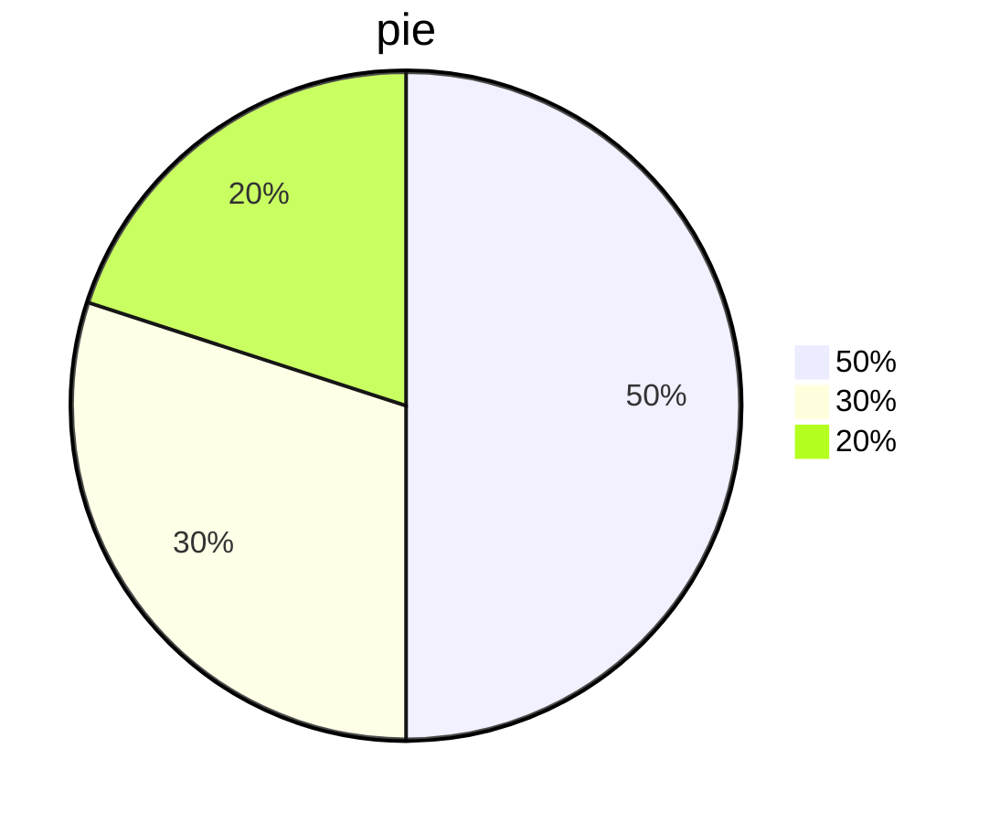
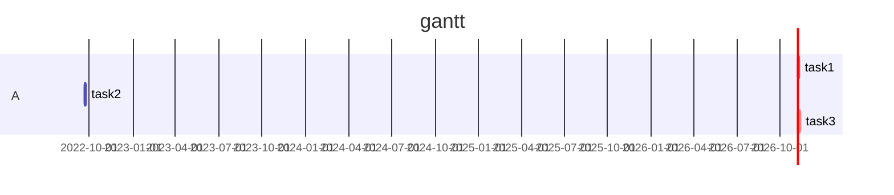
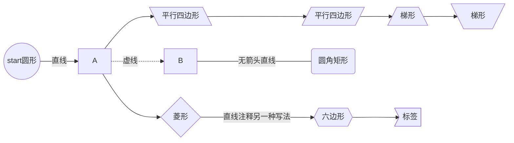
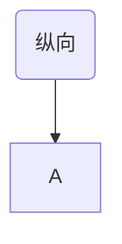

> Machine translated from Chinese by AI. For accuracy, please refer to the Chinese original.

# Level 1 heading

## Level 2 heading

### Level 3 heading

#### Level 4 heading (and so on up to level 6)


# Line break syntax

First line<br>Second line<br>Third line


Pressing Enter directly also works


# Emphasis syntax

 *Italic*

**Bold**

***Bold italic***


# Lists

## Ordered list

1. 1
2. 2
3. 3

## Unordered list

+ First
+ Second
+ Third

Plus sign

You can also use minus and asterisk


## Horizontal rule

---

---

---

Three horizontal rules

---

---

---

Three more

### Vertical divider

Used for postscript

`>`

>dsds
>
>dsds

## Pie chart




## Gantt chart



## Flowchart

- TB - top to bottom			top-bottom
- BT - bottom to top
- RL - right to left            right-left 
- LR - left to right
- TD - same as TB






---


# Markdown syntax

## Heading syntax

` # 一级标题`

`## 二级标题`

`### 三级标题`

and so on

## Emphasis syntax

` ~~内容~~`strikethrough

`*内容*`italic

`**内容**`bold

`***内容***`bold italic

## List syntax

### Ordered list

```markdown
1. 内容
2. 会自动生成（记得空格）
```

### Unordered list

```markdown
- 内容
+ 内容
* 内容
```

All can generate an unordered list

## Markdown can embed HTML

```html
<p></p>
<font color=></font>
<u></u>
<tr></tr>
<td></td>
..............
```

## Horizontal rule

```markdown
---				减号
\*\*\*			星号
\_\_\_			下划线
```

All work

## Code syntax

````markdown
`your_codes`


```select_language
your codes
```
````


## Annotations

### Superscript

`[^标注内容]`

Hello[^1]

`html内嵌`

<sup>1</sup>

### Subscript

`~标注内容~`

Hello~1~

## Line styles

### Strikethrough

`~~内容~~`

~~Hello~~

### Underline

`html内嵌语法：<u>内容</u>`

<u>Hello</u>

### Overline

`latex内嵌语法: $代码$`

```latex
$\overline{A}$
$\widehat$
$\hat{A}$
$\widetilde{A}$
$\dot{A}$
$\ddot{A}$
```

$\overline{A}$
$\widehat{A}$
$\hat{A}$
$\widetilde{A}$
$\dot{A}$
$\ddot{A}$

## Attachments

- [Dockerfile_Rules.pdf](Dockerfile_Rules.pdf)
- [encode.7z](encode.7z)