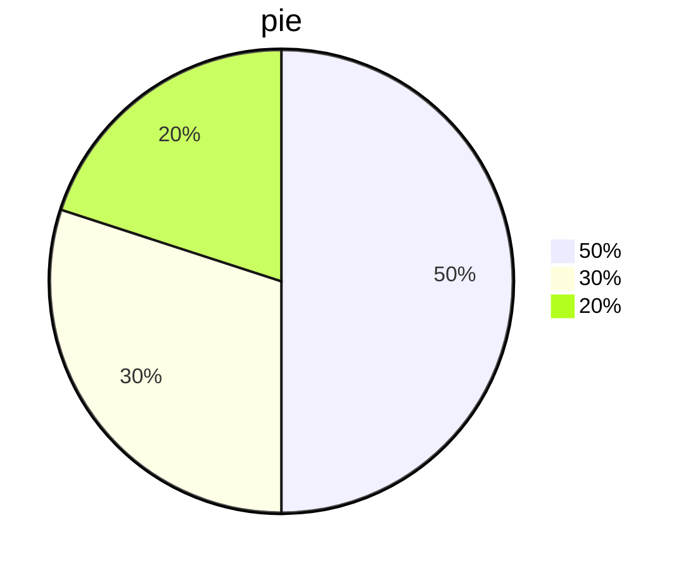
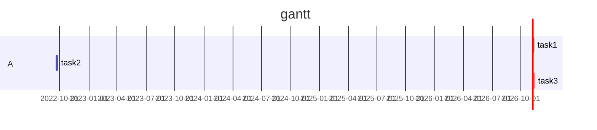
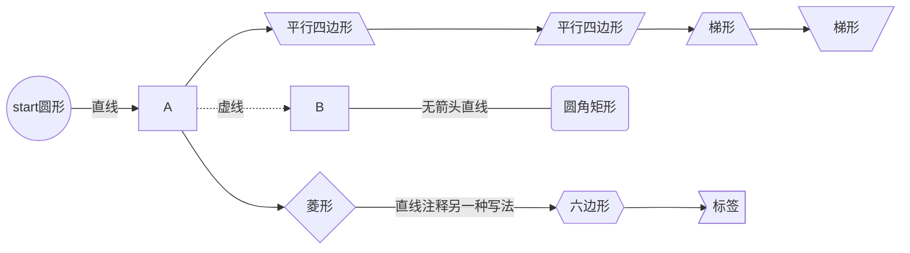
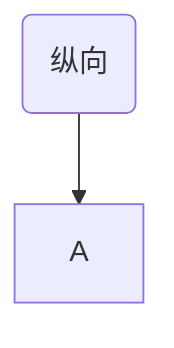

> この記事は中国語から AI により機械翻訳されたものです。正確性については中国語の原文を参照してください。


# 見出し1

## 見出し2

### 見出し3

#### 見出し4（以下同様に最大6レベル）


# 改行構文

1行目<br>2行目<br>3行目


直接改行してもかまいません


# 強調構文

 *斜体*

**太字**

***斜体太字***


# リスト

## 番号付きリスト

1. 1
2. 2
3. 3

## 順序なしリスト

+ 1番目
+ 2番目
+ 3番目

プラス記号

マイナス記号とアスタリスクも使用できます


## 区切り線

---

---

---

3本の区切り線

---

---

---

さらに3本

### 縦区切り線

追記に使用

`>`

>dsds
>
>dsds

## 円グラフ




## ガントチャート



## フローチャート

- TB - 上から下			top-bottom
- BT - 下から上
- RL - 右から左            right-left 
- LR - 左から右
- TD - TBと同じ






---


# markdown構文

## 見出し構文

` # 一级标题`

`## 二级标题`

`### 三级标题`

以下同様

## 強調構文

` ~~内容~~`打ち消し線

`*内容*`斜体

`**内容**`太字

`***内容***`斜体太字

## リスト構文

### 番号付きリスト

```markdown
1. 内容
2. 会自动生成（记得空格）
```

### 順序なしリスト

```markdown
- 内容
+ 内容
* 内容
```

どちらも順序なしリストを生成できます

## markdownはHTMLを埋め込める

```html
<p></p>
<font color=></font>
<u></u>
<tr></tr>
<td></td>
..............
```

## 区切り線

```markdown
---				减号
\*\*\*			星号
\_\_\_			下划线
```

どちらも可能

## コード構文

````markdown
`your_codes`


```select_language
your codes
```
````


## 注釈

### 上付き文字

`[^标注内容]`

こんにちは[^1]

`html内嵌`

<sup>1</sup>

### 下付き文字

`~标注内容~`

こんにちは~1~

## 線

### 打ち消し線

`~~内容~~`

~~こんにちは~~

### 下線

`html内嵌语法：<u>内容</u>`

<u>こんにちは</u>

### 上線

`latex内嵌语法: $代码$`

```latex
$\overline{A}$
$\widehat$
$\hat{A}$
$\widetilde{A}$
$\dot{A}$
$\ddot{A}$
```

$\overline{A}$
$\widehat{A}$
$\hat{A}$
$\widetilde{A}$
$\dot{A}$
$\ddot{A}$


## 添付ファイル

- [Dockerfile_Rules.pdf](Dockerfile_Rules.pdf)
- [encode.7z](encode.7z)