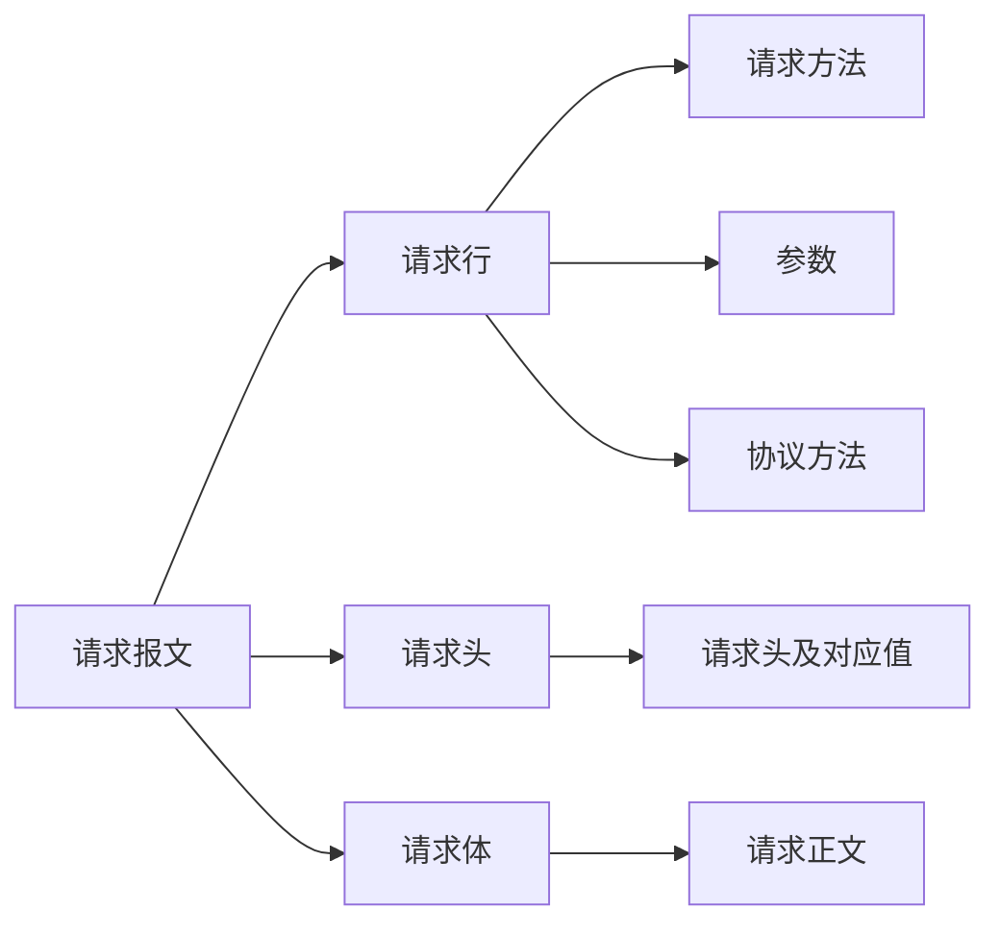
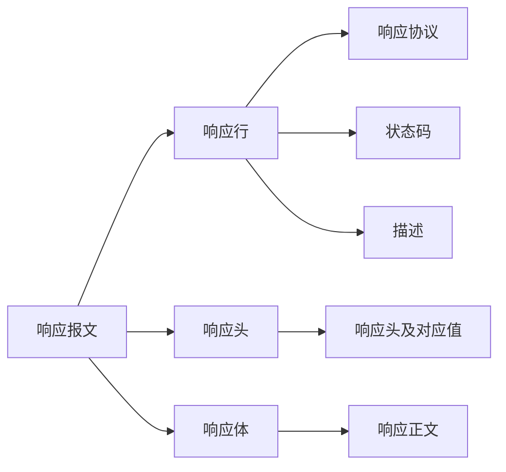

> Machine translated from Chinese by AI. For accuracy, please refer to the Chinese original.

Request (request), Response (response)

Request message:

- Request line
- Request headers
- Request body

Response message:

- Response line
- Response headers
- Response body

## Line

### Request Methods

There are many request methods (all methods are in uppercase), and each method is explained as follows:

GET   Requests to obtain the resource identified by the Request-URI

POST  Appends new data after the resource identified by the Request-URI

HEAD  Requests to obtain the response message header of the resource identified by the Request-URI

PUT   Requests the server to store a resource and to use the Request-URI as its identifier

DELETE Requests the server to delete the resource identified by the Request-URI

TRACE  Requests the server to send back the received request information, mainly used for testing or diagnostics

CONNECT Reserved for future use

OPTIONS Requests to query the performance of the server, or to query the options and requirements related to the resource

## Headers

### Request Headers

Accept The browser uses this header to tell the server the data types it supports

Accept-Charset The browser uses this header to tell the server the character set it uses

Accept-Encoding The browser uses this header to tell the server the compression formats it supports

Accept-Language The browser uses this header to tell the server the language it uses

Host The browser uses this header to tell the server which host on the server I want to access

If-Modified-Since The browser uses this header to tell the server how long it has cached the data.

Referer The browser uses this header to tell the server which web page I clicked over from (anti-hotlinking)

User-Agent The browser uses this header to tell the server the information about the current browser's operating system, as well as the browser's version number

Connection This header is used to identify whether this request uses a persistent connection or a non-persistent connection

Date

### Response Headers

Location This header is usually used together with the 302 status code; it is used to tell the browser whom to go find.

Server Tells the browser the type of the server

Content-Encoding Through this header, the server tells the browser the compression format used for the data sent back.

Content-Length: 80

Content-Language: zh-cn

Content-Type This header is used to tell the browser the type of the data sent back

Last-Modified This header is used to tell the browser the last modification time of the data

Refresh This header is used to control the browser's timed refresh

Content-Disposition Used to notify the browser to open the data sent back in download mode

Transfer-Encoding Used to notify the browser that the data is sent back in chunked form

ETag A header related to caching

Expires Used to specify the expiration time of the web page; if this value is a value < 0, the server is notifying the browser not to cache

Cache-Control: no-cache Notifies the browser not to cache

Pragma: no-cache

Data types:

text/html: HTML format
text/plain : Plain text format
text/xml : XML format
image/gif : gif image format
image/jpeg : jpg image format
image/png: png image format
video/mpeg: video
vedio/quicktime: video
application/xhtml+xml : XHTML format
application/xml : XML data format
application/atom+xml : Atom XML aggregation format
application/json : JSON data format
application/pdf : pdf format
application/msword : Word document format
application/octet-stream : Binary stream data (such as common file downloads)
application/x-www-form-urlencoded : The default encType in ` < form encType=””>`, where form data is encoded into key/value format and sent to the server (the default data submission format of forms)

## Status Codes

- 1xx: The server has accepted the browser's message but it is not yet complete
- 2xx: Success, 200
- 3xx: Redirection, 302, 304 (accessing cache)
- 4xx: Client error, 401 (not authenticated), 404 (the accessed resource was not found), 403 (no permission to access), 405 (request method not allowed)
- 5xx: Server error, 500 (internal server exception)

---

GET passes in data through /?variable=value

POST passes in data by assigning values directly in the request body