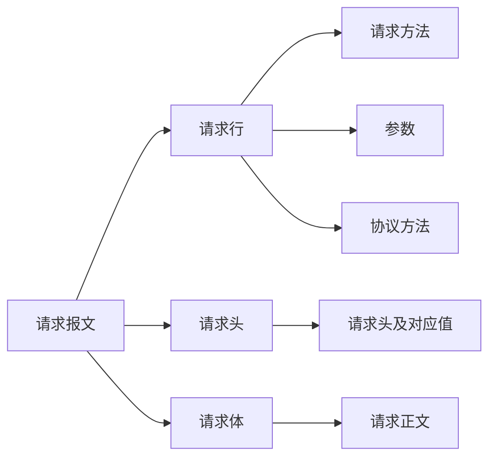
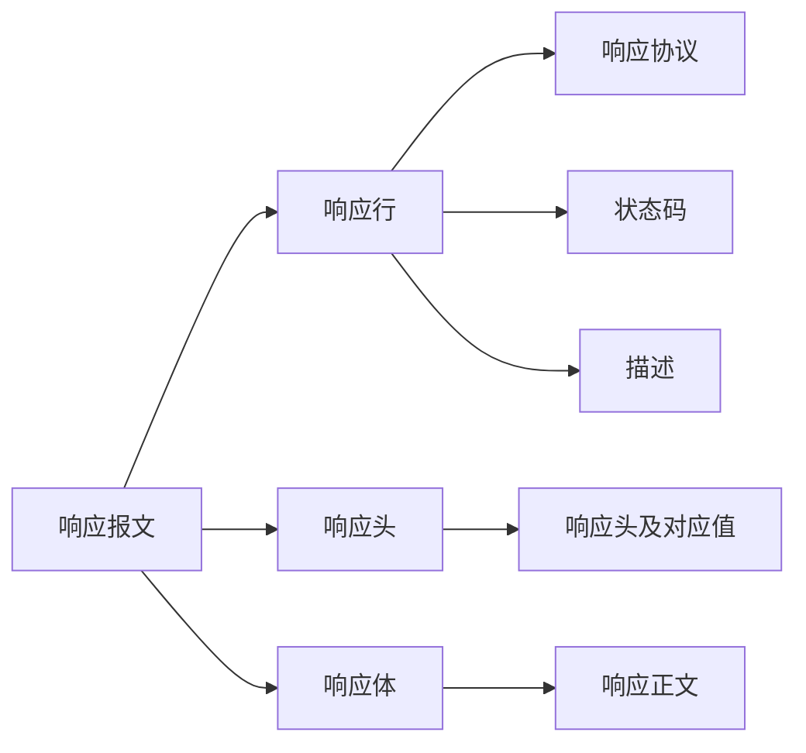

> この記事は中国語から AI により機械翻訳されたものです。正確性については中国語の原文を参照してください。

リクエスト（request）、レスポンス（response）

リクエストメッセージ：

- リクエスト行
- リクエストヘッダー
- リクエストボディ

レスポンスメッセージ：

- レスポンス行
- レスポンスヘッダー
- レスポンスボディ

## 行

### リクエストメソッド

リクエストメソッド（すべてのメソッドはすべて大文字）には複数の種類があり、各メソッドの説明は以下のとおりです：

GET   Request-URI で識別されるリソースを取得するよう要求する

POST  Request-URI で識別されるリソースに新しいデータを追加する

HEAD  Request-URI で識別されるリソースのレスポンスメッセージヘッダーを取得するよう要求する

PUT   サーバーにリソースを保存し、Request-URI をその識別子として使用するよう要求する

DELETE サーバーに Request-URI で識別されるリソースを削除するよう要求する

TRACE  サーバーに受信したリクエスト情報を返送するよう要求する。主にテストや診断に使用される

CONNECT 将来の使用のために予約されている

OPTIONS サーバーの性能、またはリソースに関連するオプションや要件を照会するよう要求する

## ヘッダー

### リクエストヘッダー

Accept ブラウザーはこのヘッダーを通じて、サポートするデータ型をサーバーに伝える

Accept-Charset ブラウザーはこのヘッダーを通じて、採用する文字セットをサーバーに伝える

Accept-Encoding ブラウザーはこのヘッダーを通じて、サポートする圧縮形式をサーバーに伝える

Accept-Language ブラウザーはこのヘッダーを通じて、採用する言語をサーバーに伝える

Host ブラウザーはこのヘッダーを通じて、サーバーのどのホストにアクセスしたいかをサーバーに伝える

If-Modified-Since ブラウザーはこのヘッダーを通じて、データをキャッシュした時刻をサーバーに伝える。

Referer ブラウザーはこのヘッダーを通じて、どの Web ページからクリックして来たのかをサーバーに伝える（ホットリンク防止）

User-Agent ブラウザーはこのヘッダーを通じて、現在のブラウザーとオペレーティングシステムの情報、およびブラウザーのバージョン番号をサーバーに伝える

Connection このヘッダーによって、今回のリクエストが持続的接続か非持続的接続かを識別する

Date

### レスポンスヘッダー

Location このヘッダーは通常 302 ステータスコードと組み合わせて使用され、ブラウザーにどこを参照すべきかを伝える。

Server ブラウザーにサーバーの種類を伝える

Content-Encoding サーバーはこのヘッダーを通じて、返送するデータで採用する圧縮形式をブラウザーに伝える。

Content-Length: 80

Content-Language: zh-cn

Content-Type このヘッダーは、返送するデータの種類をブラウザーに伝えるために使用される

Last-Modified このヘッダーは、データの最終更新時刻をブラウザーに伝えるために使用される

Refresh このヘッダーは、ブラウザーを定期的に更新する制御に使用される

Content-Disposition 返送するデータをダウンロード方式で開くようブラウザーに通知するために使用される

Transfer-Encoding データがチャンク形式で返送されることをブラウザーに通知するために使用される

ETag キャッシュ関連のヘッダー

Expires Web ページの有効期限を説明するために使用され、その値が <0 の値である場合、サーバーはブラウザーにキャッシュしないよう通知している

Cache-Control: no-cache ブラウザーにキャッシュしないよう通知する

Pragma: no-cache

データ型：

text/html：HTML 形式
text/plain ：プレーンテキスト形式
text/xml ： XML 形式
image/gif ：gif 画像形式
image/jpeg ：jpg 画像形式
image/png：png 画像形式
video/mpeg：動画
vedio/quicktime：動画
application/xhtml+xml ：XHTML 形式
application/xml ： XML データ形式
application/atom+xml ：Atom XML 集約形式
application/json ： JSON データ形式
application/pdf ：pdf 形式
application/msword ： Word 文書形式
application/octet-stream ： バイナリストリームデータ（一般的なファイルダウンロードなど）
application/x-www-form-urlencoded ：` < form encType=””>` でデフォルトの encType。フォームデータは key/value 形式にエンコードされてサーバーへ送信される（フォームのデフォルトのデータ送信形式）

## ステータスコード

- 1xx：サーバーがブラウザーのメッセージを受け取ったが未完了
- 2xx：成功、200
- 3xx：リダイレクト、302、304（キャッシュへのアクセス）
- 4xx：クライアントエラー、401（認証されていない）、404（アクセスするリソースが見つからない）、403（アクセス権限がない）、405（リクエストメソッドが許可されていない）
- 5xx：サーバーエラー、500（サーバー内部例外）

---

GET は /?変数=value を通じてデータを渡す

POST はリクエストボディ内で直接値を代入してデータを渡す