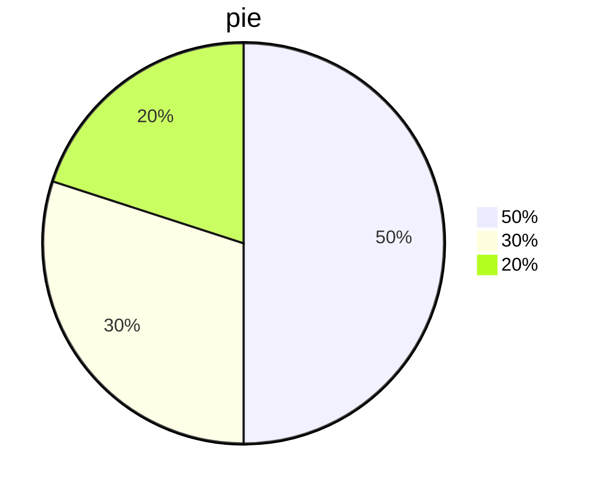
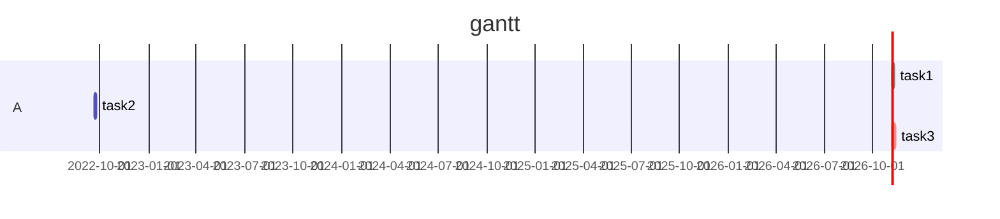
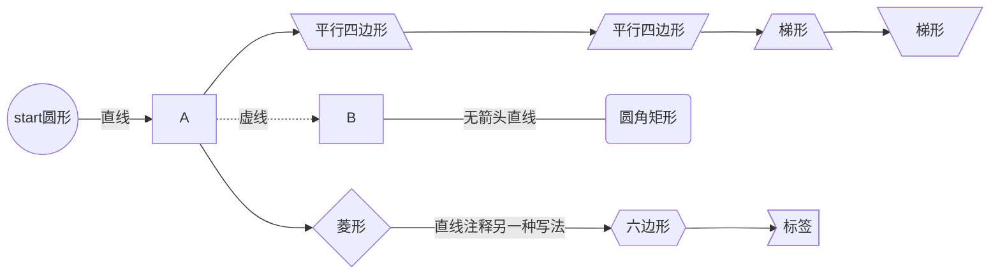
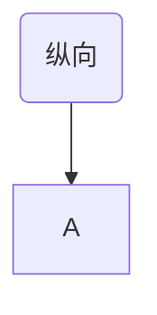

> Machine translated from Chinese by AI. For accuracy, please refer to the Chinese original.

# Level 1 Heading

## Level 2 Heading

### Level 3 Heading

#### Level 4 Heading (and so on up to Level 6)

# Line Break Syntax

First line
Second line
Third line

Pressing Enter directly also works

# Emphasis Syntax

*Italic*

**Bold**

***Bold Italic***

# Lists

## Ordered List

1. 1
2. 2
3. 3

## Unordered List

- First
- Second
- Third

Plus sign

You can also use the minus sign and asterisk

## Horizontal Rule

---

---

---

Three horizontal rules

---

---

---

Three more

### Vertical Divider

Used for postscript

`>`

> dsds
>
>
>
>
> dsds

## Pie Chart



## Gantt Chart



## Flowchart

- TB - top to bottom			top-bottom
- BT - bottom to top
- RL - right to left            right-left
- LR - left to right
- TD - Same as TB





---

# Markdown Syntax

## Heading Syntax

` # 一级标题`

`## 二级标题`

`### 三级标题`

and so on

## Emphasis Syntax

` ~~内容~~`Strikethrough

`*内容*`Italic

`**内容**`Bold

`***内容***`Bold Italic

## List Syntax

### Ordered List

```markdown
1. 内容
2. 会自动生成（记得空格）
```

### Unordered List

```markdown
- 内容
+ 内容
* 内容
```

All can generate unordered lists

## Markdown can embed HTML

```markup
<p></p>
<font color=></font>
<u></u>
<tr></tr>
<td></td>
..............
```

## Horizontal Rule

```markdown
---				减号
\*\*\*			星号
\_\_\_			下划线
```

All work

## Code Syntax

```markdown
`your_codes`

```select_language
your codes
```
```

## Annotations

### Superscript

`[^标注内容]`

Hello[^1]

`html内嵌`

1

### Subscript

`~标注内容~`

Hello~~1~~

## Text Decoration

### Strikethrough

`~~内容~~`

~~Hello~~

### Underline

`html内嵌语法：<u>内容</u>`

Hello

### Overline

`latex内嵌语法: $代码$`

```latex
$\overline{A}$
$\widehat$
$\hat{A}$
$\widetilde{A}$
$\dot{A}$
$\ddot{A}$
```

$\overline{A}$
$\widehat{A}$
$\hat{A}$
$\widetilde{A}$
$\dot{A}$
$\ddot{A}$