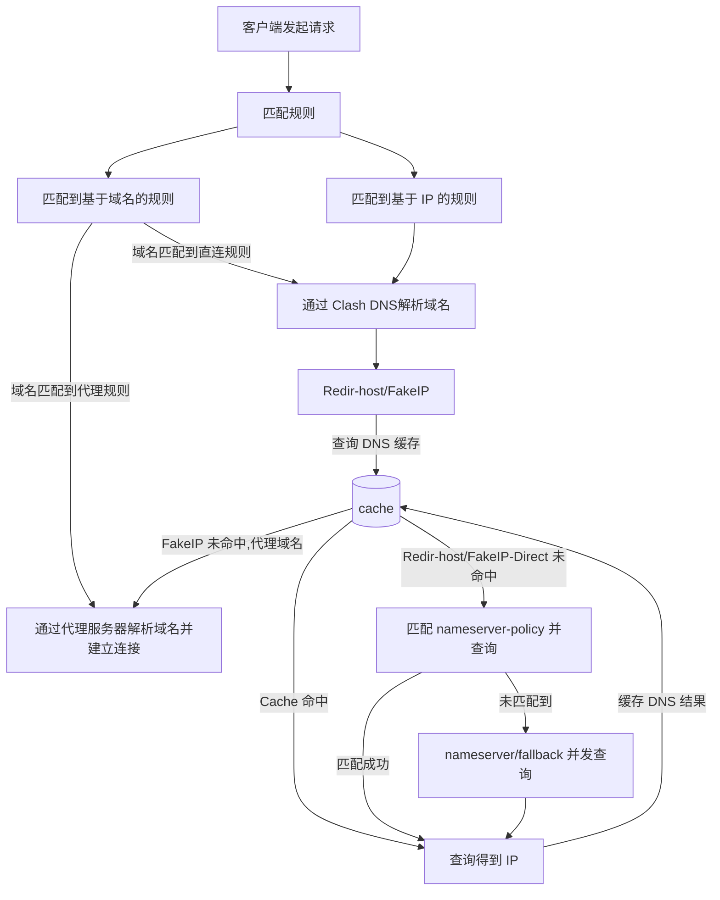

> この記事は中国語から AI により機械翻訳されたものです。正確性については中国語の原文を参照してください。

# DNS汚染が0.0.0.0のときの解決フロー

この図は **Clash Dns** の解決フローです。キャリアDNSがドメインを`0.0.0.0`に汚染し、かつfallbackに暗号化DNSが設定されていない場合、`[nameserver/fallback 并发查询]` では中間者攻撃が成立し得ます。問い合わせで得られた`0.0.0.0` はキャッシュ内のlanドメインと一致し、本機のリッスンアドレスを指すため、MATCHルールを通りません。

## 添付ファイル

- [网安实验.7z](%E7%BD%91%E5%AE%89%E5%AE%9E%E9%AA%8C.7z)