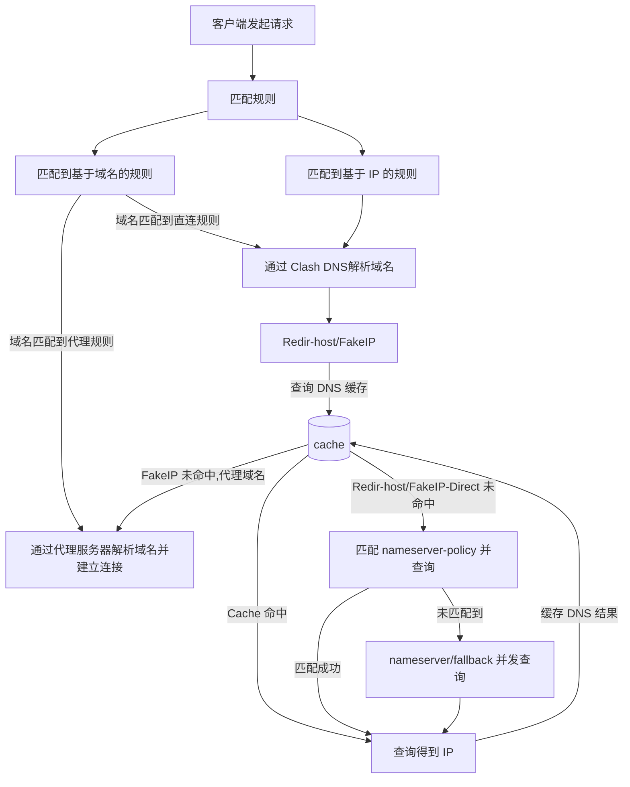

# DNS污染为0.0.0.0时的解析流程

该图为 **Clash Dns** 解析流程，若运营商dns将域名污染为`0.0.0.0` 且fallback未配置加密dns则在`[nameserver/fallback 并发查询]` 可存在中间人攻击，查询得到的`0.0.0.0` 匹配缓存中的lan域名指向本机监听地址，不会走MATCH规则

## 附件

- [网安实验.7z](%E7%BD%91%E5%AE%89%E5%AE%9E%E9%AA%8C.7z)
