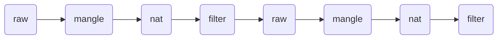
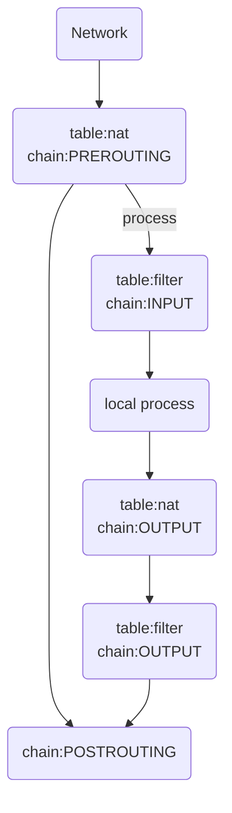

> Machine translated from Chinese by AI. For accuracy, please refer to the Chinese original.

# iptables Add, Delete, Query, and Modify







## Four Tables and Five Chains

### Four Tables

- filter	Default table
    - INPUT
    - FORWARD
    - OUTPUT
- nat	 Used to modify packets when doing NAT
    - PREROUTING
    - POSTROUTING
    - OUTPUT

- mangle	Used to modify packets
    - INPUT
    - FORWARD
    - OUTPUT 
    - PREROUTING
    - POSTROUTING
- raw	Used for advanced functions (network filtering, etc.)


### Five Chains

- **INPUT chain**: Processes incoming packets.
- **OUTPUT chain**: Processes outgoing packets.
- **FORWARD chain**: Processes forwarded packets.
- **PREROUTING chain**: Used for destination address translation (DNAT).	Changes incoming packets before routing
- **POSTOUTING chain**: Used for source address translation (SNAT)	        Changes packets when they are about to leave

## Actions

- **ACCEPT**: Accept packets.
- **DROP**: Drop packets.
- **REDIRECT**: Redirect, map, transparent proxy.
- **SNAT**: Source address translation.
- **DNAT**: Destination address translation.
- **MASQUERADE**: IP masquerading (NAT), used for ADSL.
- **LOG**: Logging.


```bash
-t, --table table：对指定的表 table 进行操作， table 必须是 raw， nat，filter，mangle 中的一个。如果不指定此选项，默认的是 filter 表。

# 通用匹配：源地址目标地址的匹配
-p：指定要匹配的数据包协议类型；
-s, --source [!] address[/mask] ：把指定的一个／一组地址作为源地址，按此规则进行过滤。当后面没有 mask 时，address 是一个地址，比如：192.168.1.1；当 mask 指定时，可以表示一组范围内的地址，比如：192.168.1.0/255.255.255.0。
-d, --destination [!] address[/mask] ：地址格式同上，但这里是指定地址为目的地址，按此进行过滤。
-i, --in-interface [!] <网络接口name> ：指定数据包的来自来自网络接口，比如最常见的 eth0 。注意：它只对 INPUT，FORWARD，PREROUTING 这三个链起作用。如果没有指定此选项， 说明可以来自任何一个网络接口。同前面类似，"!" 表示取反。
-o, --out-interface [!] <网络接口name> ：指定数据包出去的网络接口。只对 OUTPUT，FORWARD，POSTROUTING 三个链起作用。

# 查看管理命令
-L, --list [chain] 列出链 chain 上面的所有规则，如果没有指定链，列出表上所有链的所有规则。

# 规则管理命令
-A, --append chain rule-specification 在指定链 chain 的末尾插入指定的规则，也就是说，这条规则会被放到最后，最后才会被执行。规则是由后面的匹配来指定。
-I, --insert chain [rulenum] rule-specification 在链 chain 中的指定位置插入一条或多条规则。如果指定的规则号是1，则在链的头部插入。这也是默认的情况，如果没有指定规则号。
-D, --delete chain rule-specification -D, --delete chain rulenum 在指定的链 chain 中删除一个或多个指定规则。
-R num：Replays替换/修改第几条规则

# 链管理命令(这都是立即生效的)
-P, --policy chain target ：为指定的链 chain 设置策略 target。注意，只有内置的链才允许有策略，用户自定义的是不允许的。
-F, --flush [chain] 清空指定链 chain 上面的所有规则。如果没有指定链，清空该表上所有链的所有规则。
-N, --new-chain chain 用指定的名字创建一个新的链。
-X, --delete-chain [chain] ：删除指定的链，这个链必须没有被其它任何规则引用，而且这条上必须没有任何规则。如果没有指定链名，则会删除该表中所有非内置的链。
-E, --rename-chain old-chain new-chain ：用指定的新名字去重命名指定的链。这并不会对链内部造成任何影响。
-Z, --zero [chain] ：把指定链，或者表中的所有链上的所有计数器清零。

-j, --jump target <指定目标> ：即满足某条件时该执行什么样的**动作**。target 可以是内置的目标，比如 ACCEPT，也可以是用户自定义的链。
-h：显示帮助信息；
```


## Add

### Add to filter table

- Add to the end

`iptables -A INPUT -p tcp -m tcp --dport 21 -j ACCEPT`

- Add to a specified position

`iptables -I INPUT 3 -p tcp -m tcp --dport 20 -j ACCEPT`

### Add to nat table

`iptables -t nat -A POSTROUTING -s 192.168.10.0/24 -j MASQUERADE`

## Delete

```bash
iptables -D INPUT 3			#删除input的第3条规则

iptables -t nat -D POSTROUTING 1      #删除nat表中postrouting的第一条规则


iptables -F INPUT             #清空 filter表INPUT所有规则


iptables -F                           #清空所有规则


iptables -t nat -F POSTROUTING        #清空nat表POSTROUTING所有规则
```

## View

- View filter table

`iptables -L -n --line-number ` 		(no need to use `-t` to specify the default filter)

- View nat table

`iptables -t nat -vnL POSTROUTING --line-number`

## Modify

`iptables -R INPUT 3 -j DROP`		replace  


## Port forwarding

`-A PREROUTING -p tcp --dport 8022 -j REDIRECT --to-port 22`