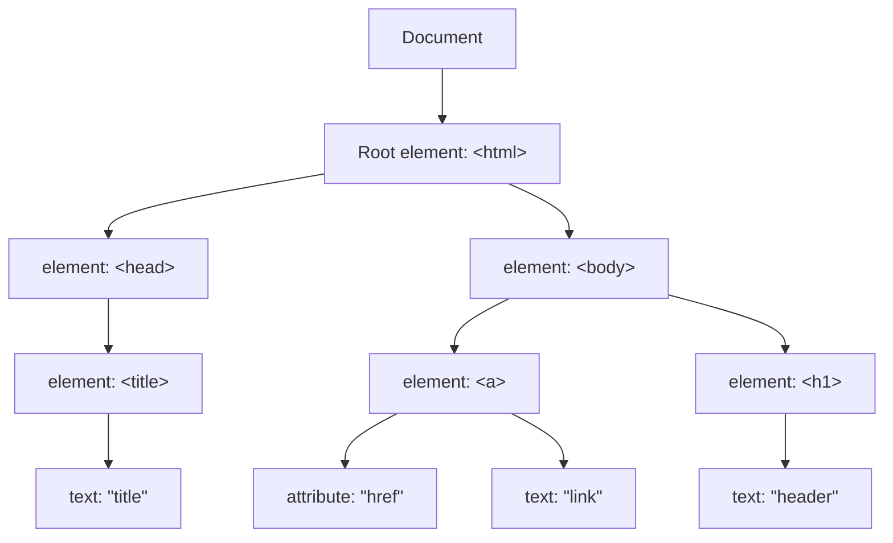

> Machine translated from Chinese by AI. For accuracy, please refer to the Chinese original.

# Web-basic

## HTML

`<p href="">text</p>`

In this tag

- p is an element
- href is an attribute
- text is text content

> ```html
> <!DOCTYPE html>
> <html>
> <head>
> <meta charset="UTF-8">
> <title>
> 页面标题</title>
> </head>
> <body>
> 
> <h1>我的第一个标题</h1>
> 
> <p>我的第一个段落。</p>
> 
> </body>
> </html>
> <!--这是注释-->
> ```

### Quick Reference

```html
<!DOCTYPE html>
<html>
<head>
<title>文档标题</title>
</head>
<body>
可见文本...
</body>
</html>


<h1>最大的标题</h1>
<h2> . . . </h2>
<h3> . . . </h3>
<h4> . . . </h4>
<h5> . . . </h5>
<h6>最小的标题</h6>
 
<p>这是一个段落。</p>
<br> （换行）
<hr> （水平线）
<!-- 这是注释 -->


<!--文本格式化-->
<b>粗体文本</b>
<u>下划线文本</u>
<code>计算机代码</code>
<em>强调文本</em>
<i>斜体文本</i>
<kbd>键盘输入</kbd> 
<pre>预格式化文本</pre>
<small>更小的文本</small>
<strong>重要的文本</strong>
 
<abbr> （缩写）
<address> （联系信息）
<bdo> （文字方向）
<blockquote> （从另一个源引用的部分）
<cite> （工作的名称）
<del> （删除的文本）
<ins> （插入的文本）
<sub> （下标文本）
<sup> （上标文本）
    
    
<!--链接-->   
普通的链接：<a href="http://www.example.com/">链接文本</a>
图像链接： <a href="http://www.example.com/"></a>
邮件链接： <a href="mailto:webmaster@example.com">发送e-mail</a>
书签：
<a id="tips">提示部分</a>
<a href="#tips">跳到提示部分</a>
    
    

<!--图片-->

    
    
    
<!--样式-->
<style type="text/css">
h1 {color:red;}
p {color:blue;}
</style>
<div>文档中的块级元素</div>
<span>文档中的内联元素</span>
    
    
<!--列表-->
	<!--无序-->
<ul>
    <li>项目</li>
    <li>项目</li>
</ul>
    
	<!--有序-->    
<ol>
    <li>第一项</li>
    <li>第二项</li>
</ol> 

	<!--定义（缩进）-->
<dl>
  <dt>项目 1</dt>
    <dd>描述项目 1</dd>
  <dt>项目 2</dt>
    <dd>描述项目 2</dd>
</dl>   
    
    
    
<!--表格-->
<!-- tr(table row) th(table header) td(table data)-->
<table border="1">
  <tr>
    <th>表格标题</th>
    <th>表格标题</th>
  </tr>
  <tr>
    <td>表格数据</td>
    <td>表格数据</td>
  </tr>
</table>
    
    
<!--框架-->
<iframe src="demo_iframe.htm"></iframe>
    
<!--表单（forms）--> 
<form action="demo_form.php" method="post/get">
<input type="text" name="email" size="40" maxlength="50">
<input type="password">
<input type="checkbox" checked="checked">
<input type="radio" checked="checked">
<input type="submit" value="Send">
<input type="reset">
<input type="hidden">
<select>
<option>苹果</option>
<option selected="selected">香蕉</option>
<option>樱桃</option>
</select>
<textarea name="comment" rows="60" cols="20"></textarea>
 
</form> 
    
    
    
&lt; 等同于 <
&gt; 等同于 >
&#169; 等同于 ©
```

---

### Tags

> Single tags have no content; double tags have content
> 
> Common attributes within tags: `id`, `class`, `style`

#### Elements

- Block elements: Layout page\<div> \<p> \<h1>... \<h6> \<ul> \<ol> \<dl> \<li> \<table> \<form>, **occupies a certain size, manually set size (defaults to one line), arranged in multiple lines**
- Inline elements: Web page content\<span> \<a> \<strong> \<em>\<br> \<input>, **size is set according to content, arranged on the same line**
- Inline-block elements (belong to inline elements, arranged horizontally but size can be set): \, **size can be set, arranged on the same line**

#### <!DOCTYPE> Declaration

Case-insensitive

```html
<!doctype html>
<!Doctype Html>
<!DOCTYPE html>
<!DOCTYPE HTML>
均可以
```

#### \<head>

Head, can add \<title>, \<style>, \<meta>, \<link>, \<script>, \<noscript> and \<base>

- \<title>	Document title
- \<base>      Sets the default link for link tags

```html
<head>
<base href="http://www.runoob.com/images/" target="_blank">
</head>
```

- \<link>	Marks the relationship between the document and external resources, often used for linking and referencing CSS

```html
<head>
<link rel="stylesheet" type="text/css" href="mystyle.css">
</head>
```

- \<style>	Can directly render HTML through CSS; this method is **inline style**

```html
<head>
    <style type="text/css">
    body{
    	background-color:yellow;
    }
    p {
    	color:blue
    }
    </style>
</head>
```

- \<meta>	Defines basic metadata, which is parsed but not rendered or displayed

```html
<meta name="keywords" contents="">
<meta name="description" content="">
<meta name="author" content="">
<meta http-equiv="refresh" content="30">	#每30s刷新网页，可定义基本行为
<meta name="viewport" content="width=device-width, initial-scale=1.0"> #设定缩放比率
```

- \<h1>-\<h6>	Headings
- \<p>\</p>	    Paragraph
- \<a href="" target="{_self, _blank, _top, _parent}" >\</a> Link
- \   Image

#### \<div>

Create a block

#### \<span>

Marks text for styling

#### \<form>

| button            | Defines a clickable button (usually used with JavaScript to start a script).   |
| ----------------- | ------------------------------------------------------------ |
| checkbox          | Defines a checkbox.                                                 |
| colorNew          | Defines a color picker.                                             |
| dateNew           | Defines a date control (including year, month, day, not time).               |
| datetimeNew       | Defines date and time controls (including year, month, day, hour, minute, second, fraction of a second, based on UTC time zone). |
| datetime-localNew | Defines date and time controls (including year, month, day, hour, minute, second, fraction of a second, without time zone). |
| emailNew          | Defines a field for an e-mail address.                                 |
| file              | Defines a file selection field and a "Browse..." button for file upload.              |
| hidden            | Defines a hidden input field.                                           |
| image             | Defines an image as a submit button.                                       |
| monthNew          | Defines month and year controls (without time zone).                        |
| numberNew         | Defines a field for entering a number.                                     |
| password          | Defines a password field (characters in the field are masked).                       |
| radio             | Defines a radio button.                                               |
| rangeNew          | Defines a control for entering a number whose exact value is unimportant (such as a slider control).   |
| reset             | Defines a reset button (resets all form values to default values).                   |
| searchNew         | Defines a text field for entering a search string.                           |
| submit            | Defines a submit button.                                               |
| telNew            | Defines a field for entering a telephone number.                                 |
| text              | Default. Defines a single-line text field (default width is 20 characters).       |
| timeNew           | Defines a control for entering time (without time zone).                         |
| urlNew            | Defines a field for entering a URL.                                    |
| weekNew           | Defines week and year controls (without time zone).                         |

Form, used for input and interaction

```html
<form action="#">	<!--同submit行为对应-->
    <input type="text" placeholder="输入内容提示"><br>
    <label>邮箱:</label><br>
    <input type="email"><br>

<!--label中通过for和id绑定，方便进行样式化-->
    
    <label for="username">用户名:</label><br>
    <input type="text" id="username"><br>
    <label for="password">密码:</label><br>
    <input type="password" id="password"><br>
    <label>是否登录</label><br>
    
<!--radio单选框通过name实现单选，同一个name下为单选效果-->   
<!--多选框为checkbox，同一个name下为多选效果-->
    
    <input type="radio" name="login">是		
    <input type="radio" name="login">否<br>
    <input type="checkbox" name="multiple">1<br>
    <input type="checkbox" name="multiple">2<br>
    <input type="checkbox" name="multiple">3<br>
    <input type="button" name="button" value=按钮><br>  
    <input type="submit" value="提交" onclick="{在此调用函数}">
</form>
```

<form action="#">
    <input type="text" placeholder="输入内容提示"><br>
    <label>Email:</label><br>
    <input type="email"><br>
    <label for="username">Username:</label><br>
    <input type="text" id="username"><br>
    <label for="password">Password:</label><br>
    <input type="password" id="password"><br>
    <label>Login?</label><br>
    <input type="radio" name="login">Yes
    <input type="radio" name="login">No<br>
     <input type="checkbox" name="multiple">1<br>
    <input type="checkbox" name="multiple">2<br>
    <input type="checkbox" name="multiple">3<br>
    <input type="button" name="button" value=按钮><br>
    <input type="submit" value="提交" onclick="{在此调用函数}">
</form>

## CSS

Internal styles (style= within a tag), inline styles (writing CSS code in HTML), and external styles (externally linking CSS code)

Priority: internal > inline > external

- Internal

```html
<p style="color: red;font-size: 16px;">
```

- Inline

    ```html
    <style>
        p {
        	color: red;
        	font-size: 16px;
        }
    </style>
    ```

- External

```html
<link rel="stylesheet" type="text/css" href="./css/style.css">
```

```css
#./css/style.css
p {
    	color: red;
    	font-size: 16px;    
}
```

### Format

```css
选择器 {
    color: red;
    font-size: 16px;
}
```

### Selectors

> id > class > tag name

- Element selector

```css
标签名 {
    
}
```

- Class selector

```css
.类名 {
    
}
```

- ID selector

```css
#id {
    
}
```

- Universal selector (selects all)

```css
* {
    
}
```

- Child element selector (specify child in parent)

```html
<div class="father">
    <p class="son">子元素选择器示例</p>
</div>
```

```css
.father > .son {
    
}
```

- Descendant selector (similar to a child after two levels of derivation, not a direct child; that is, the child element selector is not inherited in derivation) (specify a tag within a parent)

```html
<div class="father">
    <p class="son">子元素选择器示例</p>
    <div>
        <p class>后代选择器示例</p>
    </div>
</div>
```

```css
.father p {
    
}
```

- Adjacent sibling selector

```html
<h3></h3>
<p></p>
```

```css
h3 + p {
    
}

/*   选择下方相邻的标签
块 + 行内 {

}


*/
```

- Pseudo-class selector (implements interactive effects)

```css
#类名:hover{
    
}

#类名:{hover, first-child, nth-child(第n个子元素), :active}
```

| Selector                                                       | Example                  | Example Description                                        |
| ------------------------------------------------------------ | --------------------- | ----------------------------------------------- |
| [:checked](https://www.runoob.com/cssref/sel-checked.html)   | input:checked         | Selects all checked form elements                          |
| [:disabled](https://www.runoob.com/css/cssref/sel-disabled.html) | input:disabled        | Selects all disabled form elements                          |
| [:empty](https://www.runoob.com/cssref/sel-empty.html)       | p:empty               | Selects all p elements that have no child elements                       |
| [:enabled](https://www.runoob.com/cssref/sel-enable.html)    | input:enabled         | Selects all enabled form elements                          |
| [:first-of-type](https://www.runoob.com/cssref/sel-first-of-type.html) | p:first-of-type       | Selects every p element that is the first p element of its parent      |
| [:in-range](https://www.runoob.com/cssref/sel-in-range.html) | input:in-range        | Selects elements with a value within a specified range                          |
| [:invalid](https://www.runoob.com/cssref/sel-invalid.html)   | input:invalid         | Selects all invalid elements                              |
| [:last-child](https://www.runoob.com/cssref/sel-last-child.html) | p:last-child          | Selects the last child element of all p elements                   |
| [:last-of-type](https://www.runoob.com/cssref/sel-last-of-type.html) | p:last-of-type        | Selects every p element that is the last p element of its parent          |
| [:not(selector)](https://www.runoob.com/cssref/sel-not.html) | :not(p)               | Selects all elements other than p                             |
| [:nth-child(n)](https://www.runoob.com/cssref/sel-nth-child.html) | p:nth-child(2)        | Selects the second child element of the parent of all p elements           |
| [:nth-last-child(n)](https://www.runoob.com/cssref/sel-nth-last-child.html) | p:nth-last-child(2)   | Selects the second-to-last child element of all p elements                 |
| [:nth-last-of-type(n)](https://www.runoob.com/cssref/sel-nth-last-of-type.html) | p:nth-last-of-type(2) | Selects the second-to-last p child element of all p elements            |
| [:nth-of-type(n)](https://www.runoob.com/cssref/sel-nth-of-type.html) | p:nth-of-type(2)      | Selects the second p child element of all p elements                  |
| [:only-of-type](https://www.runoob.com/cssref/sel-only-of-type.html) | p:only-of-type        | Selects all elements that have only one child element that is p                 |
| [:only-child](https://www.runoob.com/cssref/sel-only-child.html) | p:only-child          | Selects all p elements that have only one child element                   |
| [:optional](https://www.runoob.com/cssref/sel-optional.html) | input:optional        | Selects element attributes without "required"                    |
| [:out-of-range](https://www.runoob.com/cssref/sel-out-of-range.html) | input:out-of-range    | Selects element attributes with values outside the specified range                  |
| [:read-only](https://www.runoob.com/cssref/sel-read-only.html) | input:read-only       | Selects element attributes that are read-only                          |
| [:read-write](https://www.runoob.com/cssref/sel-read-write.html) | input:read-write      | Selects element attributes that are not read-only                      |
| [:required](https://www.runoob.com/cssref/sel-required.html) | input:required        | Selects element attributes specified by the "required" attribute              |
| [:root](https://www.runoob.com/cssref/sel-root.html)         | root                  | Selects the root element of the document                                |
| [:target](https://www.runoob.com/cssref/sel-target.html)     | #news:target          | Selects the currently active #news element (when the clicked URL contains the anchor name)      |
| [:valid](https://www.runoob.com/cssref/sel-valid.html)       | input:valid           | Selects all attributes with valid values                            |
| [:link](https://www.runoob.com/cssref/sel-link.html)         | a:link                | Selects all unvisited links                              |
| [:visited](https://www.runoob.com/cssref/sel-visited.html)   | a:visited             | Selects all visited links                            |
| [:active](https://www.runoob.com/cssref/sel-active.html)     | a:active              | Selects the active link                                |
| [:hover](https://www.runoob.com/cssref/sel-hover.html)       | a:hover               | State when the mouse is placed on the link                          |
| [:focus](https://www.runoob.com/cssref/sel-focus.html)       | input:focus           | Selects the element that has focus after input                          |
| [:first-letter](https://www.runoob.com/cssref/sel-firstletter.html) | p:first-letter        | Selects the first letter of each <p> element                    |
| [:first-line](https://www.runoob.com/cssref/sel-firstline.html) | p:first-line          | Selects the first line of each <p> element                        |
| [:first-child](https://www.runoob.com/cssref/sel-firstchild.html) | p:first-child         | Selector matches <p> elements that are the first child of any element |
| [:before](https://www.runoob.com/cssref/sel-before.html)     | p:before              | Inserts content before each <p> element                       |
| [:after](https://www.runoob.com/cssref/sel-after.html)       | p:after               | Inserts content after each <p> element                       |
| [:lang(*language*)](https://www.runoob.com/cssref/sel-lang.html) | p:lang(it)            | Selects a starting value for the lang attribute of <p> elements               |

- Pseudo-element selector (performs special processing on specified elements)

```css
/* 将p标签首字母大写并显示为红色 */
p::first-letter {
    color: red;
    font-size:xx-large
}
```

| Selector                                                       | Example           | Example Description                                        |
| ------------------------------------------------------------ | -------------- | ----------------------------------------------- |
| [:link](https://www.runoob.com/cssref/sel-link.html)         | a:link         | Selects all unvisited links                              |
| [:visited](https://www.runoob.com/cssref/sel-visited.html)   | a:visited      | Selects all visited links                            |
| [:active](https://www.runoob.com/cssref/sel-active.html)     | a:active       | Selects the active link                                |
| [:hover](https://www.runoob.com/cssref/sel-hover.html)       | a:hover        | State when the mouse is placed on the link                          |
| [:focus](https://www.runoob.com/cssref/sel-focus.html)       | input:focus    | Selects the element that has focus after input                          |
| [:first-letter](https://www.runoob.com/cssref/sel-firstletter.html) | p:first-letter | Selects the first letter of each <p> element                    |
| [:first-line](https://www.runoob.com/cssref/sel-firstline.html) | p:first-line   | Selects the first line of each <p> element                        |
| [:first-child](https://www.runoob.com/cssref/sel-firstchild.html) | p:first-child  | Selector matches <p> elements that are the first child of any element |
| [:before](https://www.runoob.com/cssref/sel-before.html)     | p:before       | Inserts content before each <p> element                       |
| [:after](https://www.runoob.com/cssref/sel-after.html)       | p:after        | Inserts content after each <p> element                       |
| [:lang(*language*)](https://www.runoob.com/cssref/sel-lang.html) | p:lang(it)     | Selects a starting value for the lang attribute of <p> elements               |

### Attributes

Shorthand and individual properties

```html
<p style="font: bolder 509x 'Jet Brains mono';">复合属性一个属性设置多个样式</p>
```

```html
<p style="line-height: 50px;"></p> <!--设置行间距-->
```

```html
<div display: inline; background-color: ;></div> <!--块元素转换为行内元素-->
<div display: inline-block; background-color: ;></div> <!--块元素转换为行内块元素-->
<span display: block; background-color: ;></span> <!--行内元素转换为块元素-->


<!--
display:{inline, inline-block, block}
-->
```

### Box

> Margin size values: 25px 50px 75px 100px

- Content
- Padding

```css
.class: {
    padding: 25px 25px;
}

.class1 {
    padding-bottom: 25px;
}
```

- Border

```css
/* 顺时针,对位替代(没有左用右代替,没有下用上代替) */

.class {
    border: 5px solid red;
    border-radius: 25px;	/* 创建圆角 */
    border-shadow: 10px 0 0 0 aqua;		
}

.class1 {
    background-color: red;
    border-style: solid dotted dashed double;
    border-width: 10px 0 0 0;
    border-color: bludviolet;
    border-collapse: collapse;		/* 合并边框 */
}

.class2 {
    border-left: 5px red solid;
}
```

> dotted: Defines a dotted border
> 
> dashed: Defines a dashed border
> 
> solid: Defines a solid border
> 
> double: Defines two borders. The width of the two borders is the same as the value of border-width
> 
> groove: Defines a 3D grooved border. The effect depends on the border's color value
> 
> ridge: Defines a 3D ridged border. The effect depends on the border's color value
> 
> inset: Defines a 3D inset border. The effect depends on the border's color value
> 
> outset: Defines a 3D outset border. The effect depends on the border's color value

- Margin

```css
.class {
    margin: 0px;
    
}

.class1 {
    margin-top: 0px;
}
```

### Layout Methods

- Normal flow	Default HTML layout
- Float	Only floats within the parent element

```css
选择器 {
    float: left/right/none;
}
```

**When the parent element cannot contain the box, rearrangement will cause collapse**

```html
<div class=father>
    <div class=son1>son1</div>
    <div class=son2>son2</div>    
</div>
```

```css
.father {
    /* width:150px */
}

.son1 {
    width: 100px;
    height: 100px;
    float:left;
}

.son2 {
    width: 100px;
    height: 100px;
    float: right;
}
```

Solve by clearing floats

```css
/* 伪元素解决 */
.father::after {
	clear:both;    /* 对不想被浮动影响的内容使用 */
}

/* 父元素内解决 */
.father {
    overflow: hidden;
}
```

- Positioning

> - static
> - relative
> - fixed
> - absolute
> - sticky

```css
.class {
	position: relative	/* 相对正常位置移动，保留原本所占空间，不会脱离文档流 */
    top: 
    left:
    right:
    bottom: 
}
```

```css
.class {
    position: absolute; /* 会覆盖元素，不占据原本文档流空间，等于新加图层，相对父元素位置（无父元素则相对页面） */
}
```

```css
.class {
    position: static; /* 默认值，没有更改定位 */
}
```

```css
.class {
    position: fixed; /* 不占据文档流空间，新加图层，相对浏览器位置 */
}
```

- Flexbox and Grid	Responsive layout

#### rem

```css
/*
html {
    font-size: 20px;
}
*/

selector {
    width: 5rem;
    height: 5rem;		/* 根据倍率相对html中font-size来调整大小,为5倍 */
}

```

Automatically change font-size according to device width

```js
function resetHtmlFontSize() {
    document.documentElement.style.fontSize = screen.width / 10 + 'px';
}
resetHtmlFontSize();

window.onresize = resetHtmlFontSize;
```

#### Flex

The cross axis is the axis perpendicular to the main axis

```css
selector {
    display: flex;
    justify-content: 
    align-items: stretch|center|flex-start（排列起点）|flex-end（排列终点）|baseline（主轴）|initial|inherit;
    align-content: stretch|center|flex-start（排列起点）|flex-end（排列终点）|baseline|initial|inherit;(相比items为整体)
}


justify-content: center;     /* 居中排列 */
justify-content: start;      /* 从行首开始排列 */
justify-content: end;        /* 从行尾开始排列 */
justify-content: flex-start; /* 从行首起始位置开始排列 */
justify-content: flex-end;   /* 从行尾位置开始排列 */
justify-content: left;       /* 一个挨一个在对齐容器得左边缘 */
justify-content: right;      /* 元素以容器右边缘为基准，一个挨着一个对齐, */


justify-content: space-between;  /* 均匀排列每个元素
                                   首个元素放置于起点，末尾元素放置于终点 */
justify-content: space-around;  /* 均匀排列每个元素
                                   每个元素周围分配相同的空间，两侧都有空间属于当前元素 */
justify-content: space-evenly;  /* 均匀排列每个元素
                                   每个元素之间的间隔相等 */
justify-content: stretch;       /* 均匀排列每个元素
                                   'auto'-sized 的元素会被拉伸以适应容器的大小 */
```

```css
display:flex;
flex-flow:row-reverse wrap;   # 为flex-wrap，flex-direction复合
```

- flex-basis: Flex base value
    - number
    - auto
    - initial	The element's original property, will not be changed by the parent
    - inherit	Does not inherit from the parent

- flex-direction:   Direction
    - row	Left-Right

    - row-reverse	Right-Left

    - column	Top-Bottom

    - column-reverse	Bottom-Top

    - initial	The element's original property, will not be changed by the parent

    - inherit 	Does not inherit from the parent

- flex-wrap: Wrapping
    - nowrap
    - wrap
    - wrap-reverse
    - initial           The element's original property, will not be changed by the parent
    - inherit 	Does not inherit from the parent

- flex-grow: Sets the ratio of enlargement relative to other elements
    - number	Multiple
    - initial
    - inherit

- flex-shrink: Sets the ratio of shrinking relative to other elements
    - number	Multiple
    - initial
    - inherit

## JavaScript

- Internal

```html
<script></script>
```

- External

```html
<script src:"./tmp.js"></script>
```

### Variables

- var	Function scope
- let	Block scope
- const	Block scope

### Event Handling

- onClick	             Click
- onMouseOver	Mouse over
- onMouseOut	  Mouse out
- onChange	       Text content changes
- onSelect		  Text box selected
- onFocus                  Cursor focus
- onBlur                     Cursor blur

```html
<button onclick="click_event()">
    <script>
    function click_event() {
        
    }
    </script>
</button>

<!-- onclick(this)=function(this)可以将自己的元素传入function,在js中定义function是需要添加一个参数来接受实参
```

### DOM



Document Object Model

When a web page loads, a document tree is created. DOM provides an interface through which JavaScript can operate on the DOM.

```js
document.getElementById('id');
document.getElementByClassName('class');
element_id.innerHTML = '修改id选择器标签的文本内容';  //带有html标签，可以嵌入链接
element_class.innerText = '修改后的类选择文本'		//修改为为纯文本
```

DOM binding events

```html
<button>button</button>
```

```js
var button_element = document.getElementsByTagName('button')


button_element.onclick = function() {
    alert('通过DOM触发script')
}

button_element.addEventListener('click', function() {
    alert('通过addEventListner 触发')
})
```

DOM creating nodes

- appendChild()    Adds a new node to a specified node
- removeChild()    Deletes a child node
- replaceChild()    Replaces a child node
- insertBefore()    Inserts a new child node before a specified child node
- createAttribute()    Creates an attribute node
- createElement()    Creates an element node
- createTextNode()    Creates a text node
- getAttribute()    Returns the value of a specified attribute