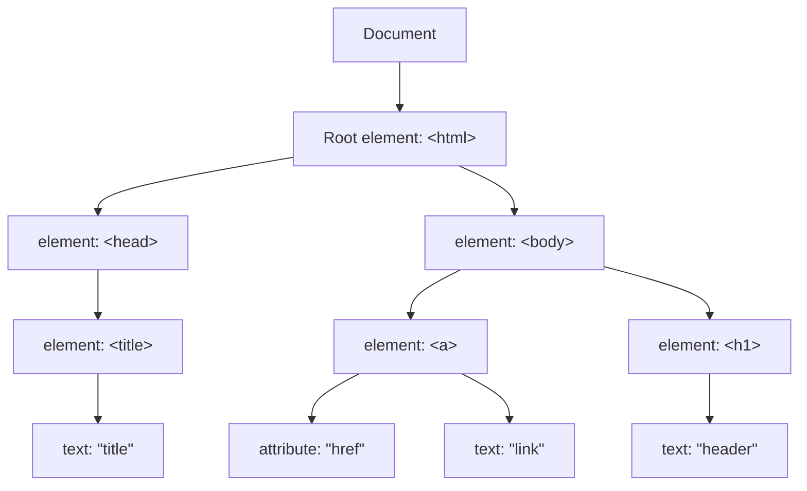

> この記事は中国語から AI により機械翻訳されたものです。正確性については中国語の原文を参照してください。

# Web-basic

## Html

`<p href="">text</p>`

このタグ内では

- pは要素
- hrefは属性
- textはテキスト

> ```html
> <!DOCTYPE html>
> <html>
> <head>
> <meta charset="UTF-8">
> <title>
> 页面标题</title>
> </head>
> <body>
> 
> <h1>我的第一个标题</h1>
> 
> <p>我的第一个段落。</p>
> 
> </body>
> </html>
> <!--这是注释-->
> ```

### クイックリファレンス

```html
<!DOCTYPE html>
<html>
<head>
<title>文档标题</title>
</head>
<body>
可见文本...
</body>
</html>


<h1>最大的标题</h1>
<h2> . . . </h2>
<h3> . . . </h3>
<h4> . . . </h4>
<h5> . . . </h5>
<h6>最小的标题</h6>
 
<p>这是一个段落。</p>
<br> （换行）
<hr> （水平线）
<!-- 这是注释 -->


<!--文本格式化-->
<b>粗体文本</b>
<u>下划线文本</u>
<code>计算机代码</code>
<em>强调文本</em>
<i>斜体文本</i>
<kbd>键盘输入</kbd> 
<pre>预格式化文本</pre>
<small>更小的文本</small>
<strong>重要的文本</strong>
 
<abbr> （缩写）
<address> （联系信息）
<bdo> （文字方向）
<blockquote> （从另一个源引用的部分）
<cite> （工作的名称）
<del> （删除的文本）
<ins> （插入的文本）
<sub> （下标文本）
<sup> （上标文本）
    
    
<!--链接-->   
普通的链接：<a href="http://www.example.com/">链接文本</a>
图像链接： <a href="http://www.example.com/"></a>
邮件链接： <a href="mailto:webmaster@example.com">发送e-mail</a>
书签：
<a id="tips">提示部分</a>
<a href="#tips">跳到提示部分</a>
    
    

<!--图片-->

    
    
    
<!--样式-->
<style type="text/css">
h1 {color:red;}
p {color:blue;}
</style>
<div>文档中的块级元素</div>
<span>文档中的内联元素</span>
    
    
<!--列表-->
	<!--无序-->
<ul>
    <li>项目</li>
    <li>项目</li>
</ul>
    
	<!--有序-->    
<ol>
    <li>第一项</li>
    <li>第二项</li>
</ol> 

	<!--定义（缩进）-->
<dl>
  <dt>项目 1</dt>
    <dd>描述项目 1</dd>
  <dt>项目 2</dt>
    <dd>描述项目 2</dd>
</dl>   
    
    
    
<!--表格-->
<!-- tr(table row) th(table header) td(table data)-->
<table border="1">
  <tr>
    <th>表格标题</th>
    <th>表格标题</th>
  </tr>
  <tr>
    <td>表格数据</td>
    <td>表格数据</td>
  </tr>
</table>
    
    
<!--框架-->
<iframe src="demo_iframe.htm"></iframe>
    
<!--表单（forms）--> 
<form action="demo_form.php" method="post/get">
<input type="text" name="email" size="40" maxlength="50">
<input type="password">
<input type="checkbox" checked="checked">
<input type="radio" checked="checked">
<input type="submit" value="Send">
<input type="reset">
<input type="hidden">
<select>
<option>苹果</option>
<option selected="selected">香蕉</option>
<option>樱桃</option>
</select>
<textarea name="comment" rows="60" cols="20"></textarea>
 
</form> 
    
    
    
&lt; 等同于 <
&gt; 等同于 >
&#169; 等同于 ©
```


---


### タグ

> 単一タグは内容なし、二重タグは内容あり
> 
> タグ内の共通属性:`id`, `class`, `style`

#### 要素

- ブロック要素： ページレイアウト\<div> \<p> \<h1>... \<h6> \<ul> \<ol> \<dl> \<li> \<table> \<form>, **一定のサイズを占め、手動でサイズ設定（デフォルトでは1行を占める）、複数行に配置**
- インライン要素： Webページ内容\<span> \<a> \<strong> \<em>\<br> \<input>, **内容に応じてサイズ設定、同じ行に配置**
- インラインブロック要素（インライン要素に属し、横並びだがサイズ設定可能）: \, **サイズ設定可能、同じ行に配置**


#### <!DOCTYPE>宣言

大文字小文字を区別しない

```html
<!doctype html>
<!Doctype Html>
<!DOCTYPE html>
<!DOCTYPE HTML>
均可以
```

#### \<head>

ヘッド。追加可能: \<title>, \<style>, \<meta>, \<link>, \<script>, \<noscript> および \<base>

- \<title>	ドキュメントのタイトル
- \<base>      リンクタグのデフォルトリンクを設定

```html
<head>
<base href="http://www.runoob.com/images/" target="_blank">
</head>
```


- \<link>	ドキュメントと外部リソースの関係をマーク。CSSのリンク参照によく使われる

```html
<head>
<link rel="stylesheet" type="text/css" href="mystyle.css">
</head>
```


- \<style>	CSSで直接HTMLをレンダリング可能。この方法は**インラインスタイル**

```html
<head>
    <style type="text/css">
    body{
    	background-color:yellow;
    }
    p {
    	color:blue
    }
    </style>
</head>
```

- \<meta>	基本的なメタデータを定義。解析されるがレンダリング表示されない

```html
<meta name="keywords" contents="">
<meta name="description" content="">
<meta name="author" content="">
<meta http-equiv="refresh" content="30">	#每30s刷新网页，可定义基本行为
<meta name="viewport" content="width=device-width, initial-scale=1.0"> #设定缩放比率
```

- \<h1>-\<h6>	見出し
- \<p>\</p>	    段落
- \<a href="" target="{_self, _blank, _top, _parent}" >\</a> リンク
- \   画像


#### \<div>

ブロックを作成

#### \<span>

テキストをマークし、スタイル設定を容易にする

#### \<form>

| button            | クリック可能なボタンを定義（通常、JavaScriptと共に使用してスクリプトを起動）。   |
| ----------------- | ------------------------------------------------------------ |
| checkbox          | チェックボックスを定義。                                                 |
| colorNew          | カラーピッカーを定義。                                                 |
| dateNew           | dateコントロールを定義（年、月、日を含み、時間は含まない）。               |
| datetimeNew       | dateおよびtimeコントロールを定義（年、月、日、時、分、秒、秒の何分の一かを含み、UTCタイムゾーンに基づく）。 |
| datetime-localNew | dateおよびtimeコントロールを定義（年、月、日、時、分、秒、秒の何分の一かを含み、タイムゾーンなし）。 |
| emailNew          | e-mailアドレス用のフィールドを定義。                                 |
| file              | ファイル選択フィールドと「参照...」ボタンを定義し、ファイルアップロードに供する。              |
| hidden            | 非表示の入力フィールドを定義。                                           |
| image             | 画像を送信ボタンとして定義。                                       |
| monthNew          | monthおよびyearコントロールを定義（タイムゾーンなし）。                        |
| numberNew         | 数値入力用のフィールドを定義。                                     |
| password          | パスワードフィールドを定義（フィールド内の文字はマスクされる）。                       |
| radio             | ラジオボタンを定義。                                               |
| rangeNew          | 正確な値が重要でない数値入力用のコントロールを定義（例：スライダーコントロール）。   |
| reset             | リセットボタンを定義（すべてのフォーム値をデフォルトにリセット）。                   |
| searchNew         | 検索文字列入力用のテキストフィールドを定義。                           |
| submit            | 送信ボタンを定義。                                               |
| telNew            | 電話番号入力用のフィールドを定義。                                 |
| text              | デフォルト。単一行のテキストフィールドを定義（デフォルト幅は20文字）。       |
| timeNew           | 時間入力用のコントロールを定義（タイムゾーンなし）。                         |
| urlNew            | URL入力用のフィールドを定義。                                    |
| weekNew           | weekおよびyearコントロールを定義（タイムゾーンなし）。                         |

フォーム。入力とインタラクションに使用

```html
<form action="#">	<!--同submit行为对应-->
    <input type="text" placeholder="输入内容提示"><br>
    <label>邮箱:</label><br>
    <input type="email"><br>

<!--label中通过for和id绑定，方便进行样式化-->
    
    <label for="username">用户名:</label><br>
    <input type="text" id="username"><br>
    <label for="password">密码:</label><br>
    <input type="password" id="password"><br>
    <label>是否登录</label><br>
    
<!--radio单选框通过name实现单选，同一个name下为单选效果-->   
<!--多选框为checkbox，同一个name下为多选效果-->
    
    <input type="radio" name="login">是		
    <input type="radio" name="login">否<br>
    <input type="checkbox" name="multiple">1<br>
    <input type="checkbox" name="multiple">2<br>
    <input type="checkbox" name="multiple">3<br>
    <input type="button" name="button" value=按钮><br>  
    <input type="submit" value="提交" onclick="{在此调用函数}">
</form>
```


<form action="#">
    <input type="text" placeholder="输入内容提示"><br>
    <label>メール:</label><br>
    <input type="email"><br>
    <label for="username">ユーザー名:</label><br>
    <input type="text" id="username"><br>
    <label for="password">パスワード:</label><br>
    <input type="password" id="password"><br>
    <label>ログインするか</label><br>
    <input type="radio" name="login">はい
    <input type="radio" name="login">いいえ<br>
     <input type="checkbox" name="multiple">1<br>
    <input type="checkbox" name="multiple">2<br>
    <input type="checkbox" name="multiple">3<br>
    <input type="button" name="button" value=按钮><br>
    <input type="submit" value="提交" onclick="{在此调用函数}">
</form>


## Css

内部スタイル（タグ内style=）、インラインスタイル（HTML内にCSSコードを記述）、外部スタイル（外部リンクCSSコード）

優先度：内部 > インライン > 外部

- 内部

```html
<p style="color: red;font-size: 16px;">
```


- インライン

    ```html
    <style>
        p {
        	color: red;
        	font-size: 16px;
        }
    </style>
    ```

- 外部

```html
<link rel="stylesheet" type="text/css" href="./css/style.css">
```

```css
#./css/style.css
p {
    	color: red;
    	font-size: 16px;    
}
```


### フォーマット

```css
选择器 {
    color: red;
    font-size: 16px;
}
```


### セレクタ

> id > クラス > タグ名

- 要素セレクタ

```css
标签名 {
    
}
```

- クラスセレクタ

```css
.类名 {
    
}
```

- IDセレクタ

```css
#id {
    
}
```

- ユニバーサルセレクタ（すべてを選択）

```css
* {
    
}
```

- 子要素セレクタ（親内で子を指定）

```html
<div class="father">
    <p class="son">子元素选择器示例</p>
</div>
```

```css
.father > .son {
    
}
```

- 子孫セレクタ（2回派生した後の子クラスに似ており、1回派生した子クラスには属さない。つまり派生では子要素セレクタを継承しない）（親内でタグを指定）
```html
<div class="father">
    <p class="son">子元素选择器示例</p>
    <div>
        <p class>后代选择器示例</p>
    </div>
</div>
```

```css
.father p {
    
}
```

- 隣接要素セレクタ

```html
<h3></h3>
<p></p>
```

```css
h3 + p {
    
}

/*   选择下方相邻的标签
块 + 行内 {

}


*/
```


- 疑似クラスセレクタ（インタラクティブ効果を実現）

```css
#类名:hover{
    
}

#类名:{hover, first-child, nth-child(第n个子元素), :active}
```

| セレクタ                                                       | 例                  | 例の説明                                        |
| ------------------------------------------------------------ | --------------------- | ----------------------------------------------- |
| [:checked](https://www.runoob.com/cssref/sel-checked.html)   | input:checked         | 選択されたすべてのフォーム要素を選択                          |
| [:disabled](https://www.runoob.com/css/cssref/sel-disabled.html) | input:disabled        | 無効化されたすべてのフォーム要素を選択                          |
| [:empty](https://www.runoob.com/cssref/sel-empty.html)       | p:empty               | 子要素を持たないすべてのp要素を選択                       |
| [:enabled](https://www.runoob.com/cssref/sel-enable.html)    | input:enabled         | 有効化されたすべてのフォーム要素を選択                          |
| [:first-of-type](https://www.runoob.com/cssref/sel-first-of-type.html) | p:first-of-type       | 選択された各p要素がその親要素の最初のp要素である      |
| [:in-range](https://www.runoob.com/cssref/sel-in-range.html) | input:in-range        | 要素の指定範囲内の値を選択                          |
| [:invalid](https://www.runoob.com/cssref/sel-invalid.html)   | input:invalid         | すべての無効な要素を選択                              |
| [:last-child](https://www.runoob.com/cssref/sel-last-child.html) | p:last-child          | すべてのp要素の最後の子要素を選択                   |
| [:last-of-type](https://www.runoob.com/cssref/sel-last-of-type.html) | p:last-of-type        | 各p要素がその親要素の最後のp要素であるものを選択          |
| [:not(selector)](https://www.runoob.com/cssref/sel-not.html) | :not(p)               | p以外のすべての要素を選択                             |
| [:nth-child(n)](https://www.runoob.com/cssref/sel-nth-child.html) | p:nth-child(2)        | すべてのp要素の親要素の2番目の子要素を選択           |
| [:nth-last-child(n)](https://www.runoob.com/cssref/sel-nth-last-child.html) | p:nth-last-child(2)   | すべてのp要素の後ろから2番目の子要素を選択                 |
| [:nth-last-of-type(n)](https://www.runoob.com/cssref/sel-nth-last-of-type.html) | p:nth-last-of-type(2) | すべてのp要素の後ろから2番目がpである子要素を選択            |
| [:nth-of-type(n)](https://www.runoob.com/cssref/sel-nth-of-type.html) | p:nth-of-type(2)      | すべてのp要素の2番目がpである子要素を選択                  |
| [:only-of-type](https://www.runoob.com/cssref/sel-only-of-type.html) | p:only-of-type        | 子要素が1つだけでそれがpであるすべての要素を選択                 |
| [:only-child](https://www.runoob.com/cssref/sel-only-child.html) | p:only-child          | 子要素が1つだけのすべてのp要素を選択                   |
| [:optional](https://www.runoob.com/cssref/sel-optional.html) | input:optional        | "required"がない要素属性を選択                    |
| [:out-of-range](https://www.runoob.com/cssref/sel-out-of-range.html) | input:out-of-range    | 指定範囲外の値の要素属性を選択                  |
| [:read-only](https://www.runoob.com/cssref/sel-read-only.html) | input:read-only       | 読み取り専用属性の要素属性を選択                          |
| [:read-write](https://www.runoob.com/cssref/sel-read-write.html) | input:read-write      | 読み取り専用属性がない要素属性を選択                      |
| [:required](https://www.runoob.com/cssref/sel-required.html) | input:required        | "required"属性が指定された要素属性を選択              |
| [:root](https://www.runoob.com/cssref/sel-root.html)         | root                  | ドキュメントのルート要素を選択                                |
| [:target](https://www.runoob.com/cssref/sel-target.html)     | #news:target          | 現在アクティブな#news要素を選択（URLにアンカー名が含まれるものをクリック）      |
| [:valid](https://www.runoob.com/cssref/sel-valid.html)       | input:valid           | すべての有効な値の属性を選択                            |
| [:link](https://www.runoob.com/cssref/sel-link.html)         | a:link                | すべての未訪問リンクを選択                              |
| [:visited](https://www.runoob.com/cssref/sel-visited.html)   | a:visited             | すべての訪問済みリンクを選択                            |
| [:active](https://www.runoob.com/cssref/sel-active.html)     | a:active              | 現在アクティブなリンクを選択                                |
| [:hover](https://www.runoob.com/cssref/sel-hover.html)       | a:hover               | マウスをリンク上に置いた状態                          |
| [:focus](https://www.runoob.com/cssref/sel-focus.html)       | input:focus           | 入力後にフォーカスを持つ要素を選択                          |
| [:first-letter](https://www.runoob.com/cssref/sel-firstletter.html) | p:first-letter        | 各<p>要素の最初の文字を選択                    |
| [:first-line](https://www.runoob.com/cssref/sel-firstline.html) | p:first-line          | 各<p>要素の最初の行を選択                        |
| [:first-child](https://www.runoob.com/cssref/sel-firstchild.html) | p:first-child         | 任意の要素の最初の子要素に属する<p>要素に一致するセレクタ |
| [:before](https://www.runoob.com/cssref/sel-before.html)     | p:before              | 各<p>要素の前に内容を挿入                       |
| [:after](https://www.runoob.com/cssref/sel-after.html)       | p:after               | 各<p>要素の後に内容を挿入                       |
| [:lang(*language*)](https://www.runoob.com/cssref/sel-lang.html) | p:lang(it)            | <p>要素のlang属性に開始値を選択               |

- 疑似要素セレクタ（指定要素に特別な処理を行う）

```css
/* 将p标签首字母大写并显示为红色 */
p::first-letter {
    color: red;
    font-size:xx-large
}
```

| セレクタ                                                       | 例           | 例の説明                                        |
| ------------------------------------------------------------ | -------------- | ----------------------------------------------- |
| [:link](https://www.runoob.com/cssref/sel-link.html)         | a:link         | すべての未訪問リンクを選択                              |
| [:visited](https://www.runoob.com/cssref/sel-visited.html)   | a:visited      | すべての訪問済みリンクを選択                            |
| [:active](https://www.runoob.com/cssref/sel-active.html)     | a:active       | 現在アクティブなリンクを選択                                |
| [:hover](https://www.runoob.com/cssref/sel-hover.html)       | a:hover        | マウスをリンク上に置いた状態                          |
| [:focus](https://www.runoob.com/cssref/sel-focus.html)       | input:focus    | 入力後にフォーカスを持つ要素を選択                          |
| [:first-letter](https://www.runoob.com/cssref/sel-firstletter.html) | p:first-letter | 各<p>要素の最初の文字を選択                    |
| [:first-line](https://www.runoob.com/cssref/sel-firstline.html) | p:first-line   | 各<p>要素の最初の行を選択                        |
| [:first-child](https://www.runoob.com/cssref/sel-firstchild.html) | p:first-child  | 任意の要素の最初の子要素に属する<p>要素に一致するセレクタ |
| [:before](https://www.runoob.com/cssref/sel-before.html)     | p:before       | 各<p>要素の前に内容を挿入                       |
| [:after](https://www.runoob.com/cssref/sel-after.html)       | p:after        | 各<p>要素の後に内容を挿入                       |
| [:lang(*language*)](https://www.runoob.com/cssref/sel-lang.html) | p:lang(it)     | <p>要素のlang属性に開始値を選択               |


### 属性

複合プロパティと独立プロパティ

```html
<p style="font: bolder 509x 'Jet Brains mono';">复合属性一个属性设置多个样式</p>
```

```html
<p style="line-height: 50px;"></p> <!--设置行间距-->
```

```html
<div display: inline; background-color: ;></div> <!--块元素转换为行内元素-->
<div display: inline-block; background-color: ;></div> <!--块元素转换为行内块元素-->
<span display: block; background-color: ;></span> <!--行内元素转换为块元素-->


<!--
display:{inline, inline-block, block}
-->
```


### ボックス

> マージンサイズ値: 25px 50px 75px 100px

- 内容 Cotent
- 内側の余白 Padding

```css
.class: {
    padding: 25px 25px;
}

.class1 {
    padding-bottom: 25px;
}
```


- 境界線 Border

```css
/* 顺时针,对位替代(没有左用右代替,没有下用上代替) */

.class {
    border: 5px solid red;
    border-radius: 25px;	/* 创建圆角 */
    border-shadow: 10px 0 0 0 aqua;		
}

.class1 {
    background-color: red;
    border-style: solid dotted dashed double;
    border-width: 10px 0 0 0;
    border-color: bludviolet;
    border-collapse: collapse;		/* 合并边框 */
}

.class2 {
    border-left: 5px red solid;
}
```

> dotted: 点線の境界線を定義
> 
> dashed: 破線の境界線を定義
> 
> solid: 実線の境界線を定義
> 
> double: 二重の境界線を定義。2つの境界線の幅はborder-widthの値と同じ
> 
> groove: 3Dの溝付き境界線を定義。効果は境界線の色の値に依存
> 
> ridge: 3Dの隆起境界線を定義。効果は境界線の色の値に依存
> 
> inset: 3Dの埋め込み境界線を定義。効果は境界線の色の値に依存
> 
> outset: 3Dの突出境界線を定義。効果は境界線の色の値に依存

- 外側の余白 Margin

```css
.class {
    margin: 0px;
    
}

.class1 {
    margin-top: 0px;
}
```


### レイアウト方式

- 標準フロー	デフォルトのHTMLレイアウト
- フロート	親要素内でのみフロート

```css
选择器 {
    float: left/right/none;
}
```


**親要素がボックスを収容できないとき、再配置すると崩れが発生する**

```html
<div class=father>
    <div class=son1>son1</div>
    <div class=son2>son2</div>    
</div>
```


```css
.father {
    /* width:150px */
}

.son1 {
    width: 100px;
    height: 100px;
    float:left;
}

.son2 {
    width: 100px;
    height: 100px;
    float: right;
}
```

フロートのクリアで解決

```css
/* 伪元素解决 */
.father::after {
	clear:both;    /* 对不想被浮动影响的内容使用 */
}

/* 父元素内解决 */
.father {
    overflow: hidden;
}
```


- 配置

> - static
> - relative
> - fixed
> - absolute
> - sticky

```css
.class {
	position: relative	/* 相对正常位置移动，保留原本所占空间，不会脱离文档流 */
    top: 
    left:
    right:
    bottom: 
}
```

```css
.class {
    position: absolute; /* 会覆盖元素，不占据原本文档流空间，等于新加图层，相对父元素位置（无父元素则相对页面） */
}
```

```css
.class {
    position: static; /* 默认值，没有更改定位 */
}
```

```css
.class {
    position: fixed; /* 不占据文档流空间，新加图层，相对浏览器位置 */
}
```


- Flebox と Grid		レスポンシブレイアウト

#### rem

```css
/*
html {
    font-size: 20px;
}
*/

selector {
    width: 5rem;
    height: 5rem;		/* 根据倍率相对html中font-size来调整大小,为5倍 */
}

```

デバイス幅に応じてfont-sizeを自動変更

```js
function resetHtmlFontSize() {
    document.documentElement.style.fontSize = screen.width / 10 + 'px';
}
resetHtmlFontSize();

window.onresize = resetHtmlFontSize;
```


#### Flex

クロス軸は主軸に垂直な軸線

```css
selector {
    display: flex;
    justify-content: 
    align-items: stretch|center|flex-start（排列起点）|flex-end（排列终点）|baseline（主轴）|initial|inherit;
    align-content: stretch|center|flex-start（排列起点）|flex-end（排列终点）|baseline|initial|inherit;(相比items为整体)
}


justify-content: center;     /* 居中排列 */
justify-content: start;      /* 从行首开始排列 */
justify-content: end;        /* 从行尾开始排列 */
justify-content: flex-start; /* 从行首起始位置开始排列 */
justify-content: flex-end;   /* 从行尾位置开始排列 */
justify-content: left;       /* 一个挨一个在对齐容器得左边缘 */
justify-content: right;      /* 元素以容器右边缘为基准，一个挨着一个对齐, */


justify-content: space-between;  /* 均匀排列每个元素
                                   首个元素放置于起点，末尾元素放置于终点 */
justify-content: space-around;  /* 均匀排列每个元素
                                   每个元素周围分配相同的空间，两侧都有空间属于当前元素 */
justify-content: space-evenly;  /* 均匀排列每个元素
                                   每个元素之间的间隔相等 */
justify-content: stretch;       /* 均匀排列每个元素
                                   'auto'-sized 的元素会被拉伸以适应容器的大小 */
```

```css
display:flex;
flex-flow:row-reverse wrap;   # 为flex-wrap，flex-direction复合
```

- flex-basis: 伸縮基準値
    - number
    - auto
    - initial	要素本来のプロパティで、親によって変更されない
    - inherit	親から継承しない

- flex-direction:   方向
    - row	左-右

    - row-reverse	右-左

    - column	上-下

    - column-reverse	下-上

    - initial	要素本来のプロパティで、親によって変更されない

    - inherit 	親から継承しない

- flex-wrap: 折り返し
    - nowrap
    - wrap
    - wrap-reverse
    - initial           要素本来のプロパティで、親によって変更されない
    - inherit 	親から継承しない

- flex-grow: 他の要素に対する拡大比率を設定
    - number	倍数
    - initial
    - inherit

- flex-shrink: 他の要素に対する縮小比率を設定
    - number	倍数
    - initial
    - inherit


## Javascript

- 内部

```html
<script></script>
```


- 外部

```html
<script src:"./tmp.js"></script>
```


### 変数

- var	関数スコープ
- let	ブロックスコープ
- const	ブロックスコープ


### イベント処理

- onClick	             クリック
- onMouseOver	マウスが通過
- onMouseOut	  マウスが出る
- onChange	       テキスト内容が変更
- onSelect		  テキストボックスが選択
- onFocus                  カーソルが集まる
- onBlur                     カーソルを外す


```html
<button onclick="click_event()">
    <script>
    function click_event() {
        
    }
    </script>
</button>

<!-- onclick(this)=function(this)可以将自己的元素传入function,在js中定义function是需要添加一个参数来接受实参
```


### DOM




Document Object Model

Webページの読み込み時にドキュメントツリーが作成され、DOMはJavaScriptを通じてDOMを操作できるインターフェースを提供する

```js
document.getElementById('id');
document.getElementByClassName('class');
element_id.innerHTML = '修改id选择器标签的文本内容';  //带有html标签，可以嵌入链接
element_class.innerText = '修改后的类选择文本'		//修改为为纯文本
```


DOMイベントのバインド

```html
<button>button</button>
```


```js
var button_element = document.getElementsByTagName('button')


button_element.onclick = function() {
    alert('通过DOM触发script')
}

button_element.addEventListener('click', function() {
    alert('通过addEventListner 触发')
})
```


DOMノードの作成

- appendChild()    指定ノードに新しいノードを追加
- removeChild()    子ノードを削除
- replaceChild()    子ノードを置換
- insertBefore()    指定子ノードの前に新しい子ノードを挿入
- createAttribute()    属性ノードを作成
- createElement()    要素ノードを作成
- createTextNode()    テキストノードを作成
- getAttribute()    指定属性値を返す